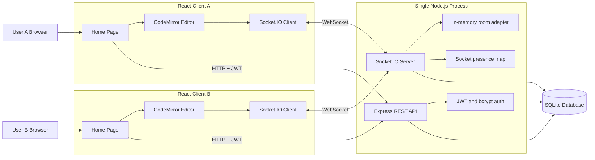
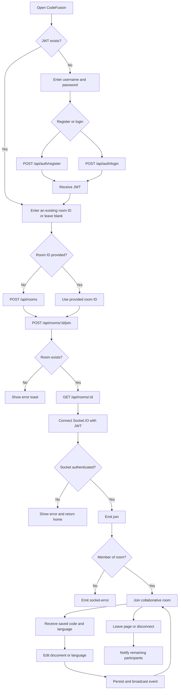
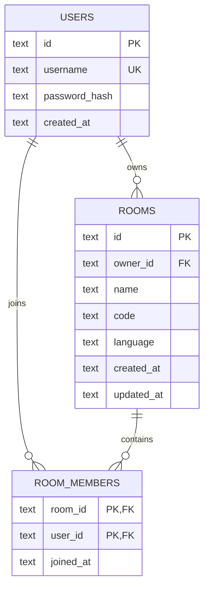
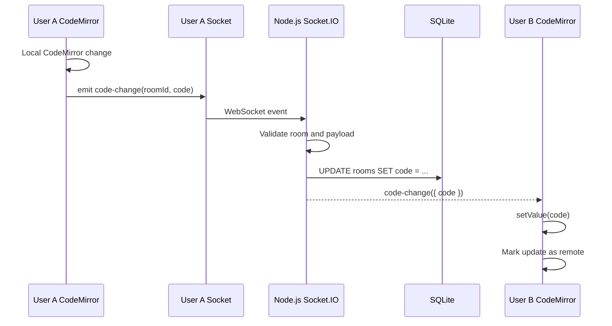
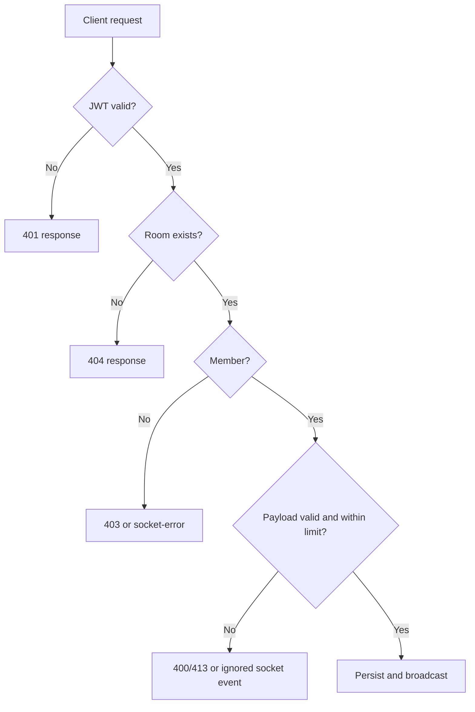
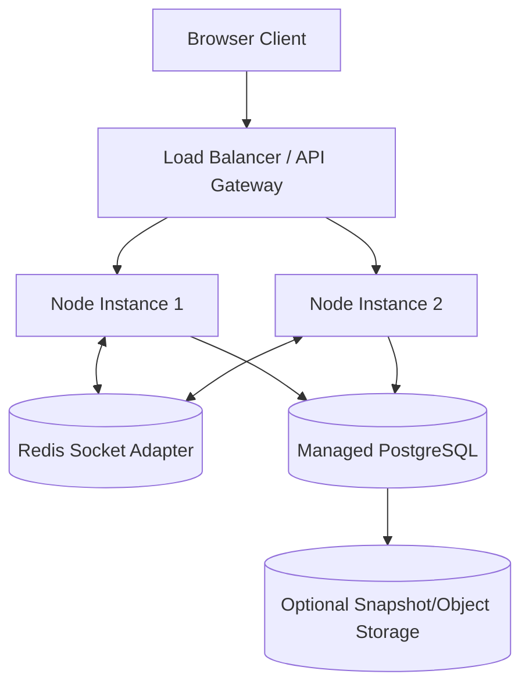

# ⚡ CodeFusion

<p align="center">
  
</p>

<p align="center">
  <strong>Collaborate. Code. Ship faster.</strong><br />
  A persistent, authenticated, real-time code editor for pair programming, interviews, mentoring, and remote debugging.
</p>

<p align="center">
  <a href="https://github.com/SonamNarula/CodeFusion-a-collaborative-real-time-code-editor"></a>
  
  
  
  
</p>

<p align="center">
  <a href="#-run-it-in-60-seconds">Run it in 60 seconds</a> ·
  <a href="#17-real-time-data-flow">How it works</a> ·
  <a href="#26-interview-question-bank">Interview prep</a>
</p>

CodeFusion is a full-stack, authenticated, real-time collaborative code editor. Users can create or join persistent coding rooms, edit a shared document, see active participants, and change the editor language while working together.

The project is intentionally designed as an interview-ready system design example: it demonstrates HTTP APIs, JWT authentication, password hashing, SQLite persistence, Socket.IO rooms, presence events, browser editor integration, reconnection behavior, and the trade-offs of a last-write-wins synchronization model.

> **Current synchronization model:** CodeFusion broadcasts the complete document on every edit. This is simple and easy to understand, but it is not CRDT- or OT-based conflict-free collaboration.

## 🚀 Run It in 60 Seconds

### 1. Clone the repository

```bash
git clone https://github.com/SonamNarula/CodeFusion-a-collaborative-real-time-code-editor.git
cd CodeFusion-a-collaborative-real-time-code-editor
```

### 2. Install dependencies

```bash
npm install
```

### 3. Start the backend

Open **Terminal 1**:

```bash
npm run server:dev
```

You should see:

```text
CodeFusion listening on port 5000
```

### 4. Start the frontend

Open **Terminal 2** in the same project folder:

```bash
npm run start:front
```

### 5. Open the app

Visit **[http://localhost:3000](http://localhost:3000)**.

Then:

1. Click **Create account** and register.
2. Leave the room field empty to create a new room.
3. Copy the room ID.
4. Open another browser window or incognito tab.
5. Register/sign in with another account.
6. Enter the copied room ID.
7. Type in either editor and watch the other client update.

> **Port 5000 already in use?** Start the backend on another port:
>
> ```bash
> PORT=5050 npm run server:dev
> ```
>
> Then update the frontend proxy in `package.json` from `http://localhost:5000` to `http://localhost:5050`, or configure `REACT_APP_BACKEND_URL`.

### Quick troubleshooting

| Problem | Fix |
|---|---|
| `npm install` fails while building `better-sqlite3` | Use Node.js 18+ and rerun `npm install` |
| Browser opens but API calls fail | Confirm the backend terminal is running |
| Port `5000` is occupied | Use `PORT=5050` and update the frontend backend URL |
| Socket says authentication failed | Sign out, sign in again, and reload the room |
| Room data disappears unexpectedly | Check `DATABASE_PATH`; do not use a temporary database path |

---

## Table of Contents

1. [Product Overview](#1-product-overview)
2. [Run It in 60 Seconds](#-run-it-in-60-seconds)
3. [Implemented Features](#2-implemented-features)
4. [Technology Stack](#3-technology-stack)
5. [Architecture at a Glance](#4-architecture-at-a-glance)
6. [Repository Structure](#5-repository-structure)
7. [Prerequisites](#6-prerequisites)
8. [Installation](#7-installation)
9. [Configuration](#8-configuration)
10. [Running the Application](#9-running-the-application)
11. [User Journey](#10-user-journey)
12. [Frontend Architecture](#11-frontend-architecture)
13. [Backend Architecture](#12-backend-architecture)
14. [Authentication Design](#13-authentication-design)
15. [Database Design](#14-database-design)
16. [HTTP API Reference](#15-http-api-reference)
17. [Socket.IO Protocol](#16-socketio-protocol)
18. [Real-Time Data Flow](#17-real-time-data-flow)
19. [Editor Synchronization](#18-editor-synchronization)
20. [Presence and Disconnect Handling](#19-presence-and-disconnect-handling)
21. [Error Handling](#20-error-handling)
22. [Consistency and Concurrency](#21-consistency-and-concurrency)
23. [System Design](#22-system-design)
24. [Scalability](#23-scalability)
25. [Security Review](#24-security-review)
26. [Testing and Validation](#25-testing-and-validation)
27. [Interview Question Bank](#26-interview-question-bank)
28. [Trade-Offs](#27-trade-offs)
29. [Roadmap](#28-roadmap)

---

## 1. Product Overview

### Problem

Pair programming, interviews, mentoring, and remote debugging often require two or more people to look at and edit the same source file. Screen sharing is passive, local editors are not synchronized, and sending updated files back and forth creates unnecessary friction.

### Solution

CodeFusion provides:

1. An account system.
2. Persistent collaborative rooms.
3. A browser-based CodeMirror editor.
4. Socket.IO room communication.
5. Saved latest code and language state.
6. Participant presence.

### Typical use case

```text
Register
  -> Create a room
  -> Share the room ID
  -> Other user signs in and joins
  -> Both users edit the shared document
  -> Changes are broadcast and persisted
```

### Current boundaries

CodeFusion currently supports one document per room. It does not execute code, store edit history, synchronize cursors, or resolve simultaneous edits with CRDT/OT algorithms.

---

## 2. Implemented Features

| Feature | Status | Implementation |
|---|---|---|
| User registration | Implemented | `POST /api/auth/register` |
| User login | Implemented | `POST /api/auth/login` |
| Password hashing | Implemented | `bcryptjs` |
| JWT authentication | Implemented | HTTP middleware and Socket.IO middleware |
| Room creation | Implemented | `POST /api/rooms` |
| Room persistence | Implemented | SQLite `rooms` table |
| Room membership | Implemented | SQLite `room_members` table |
| Room entry | Implemented | `/api/rooms/:id/join` |
| Real-time code sync | Implemented | `code-change` event |
| Real-time language sync | Implemented | `language-change` event |
| Initial document loading | Implemented | `sync-code` event and room API |
| Active participant list | Implemented | `joined` event |
| Disconnect notifications | Implemented | `disconnecting` lifecycle event |
| Reconnection attempts | Implemented | Socket.IO client configuration |
| JavaScript/Python/HTML/JSON modes | Implemented | CodeMirror modes |
| Code execution | Not implemented | Deliberately excluded for safety |
| Cursor synchronization | Not implemented | Future enhancement |
| CRDT/OT conflict resolution | Not implemented | Future enhancement |
| Multi-instance deployment | Not implemented | Requires shared adapter/state |

---

## 3. Technology Stack

### Runtime and server

| Technology | Version source | Responsibility |
|---|---|---|
| Node.js | Runtime | Runs the backend |
| Express | `^4.17.3` | HTTP API and production static hosting |
| Node `http` | Built-in | Wraps Express so Socket.IO can attach |
| Socket.IO | `^4.4.1` | Authenticated real-time room communication |

### Persistence and authentication

| Technology | Responsibility |
|---|---|
| `better-sqlite3` | Synchronous SQLite access |
| `bcryptjs` | Password hashing and verification |
| `jsonwebtoken` | Seven-day signed access tokens |
| Node `crypto.randomUUID()` | User and room identifiers |

### Frontend

| Technology | Responsibility |
|---|---|
| React 17 | UI composition and lifecycle |
| React Router 6 | `/` and `/editor/:roomId` navigation |
| CodeMirror 5 | In-browser editor |
| `socket.io-client` | Browser real-time connection |
| `react-hot-toast` | Success and error notifications |
| `react-avatar` | Participant avatars |
| Create React App | Frontend development and production build |

### Development and testing

| Tool | Purpose |
|---|---|
| Nodemon | Restarts backend during development |
| Testing Library | React component smoke testing |
| Jest | Test runner included by Create React App |

---

## 4. Architecture at a Glance

### Current architecture



### Responsibilities

- **Browser:** renders forms, stores the JWT, loads room state, and edits code.
- **Express:** handles authentication and room APIs.
- **JWT middleware:** identifies the user for protected HTTP requests.
- **Socket.IO middleware:** authenticates the WebSocket handshake.
- **Socket.IO room adapter:** tracks active sockets in rooms inside the current process.
- **SQLite:** stores users, memberships, room metadata, and the latest document.
- **CodeMirror:** renders the editable document and emits local changes.

### Important distinction

SQLite is persistent, but Socket.IO room membership is not. A process restart preserves users and room documents but removes all active connections. Clients must reconnect and join again.

---

## 5. Repository Structure

```text
CodeFusion/
├── package.json
├── package-lock.json
├── README.md
├── server.js
├── public/
│   ├── code-sync.png
│   ├── favicon.ico
│   ├── index.html
│   └── manifest.json
└── src/
    ├── Actions.js
    ├── App.css
    ├── App.js
    ├── App.test.js
    ├── index.css
    ├── index.js
    ├── socket.js
    ├── components/
    │   ├── Client.js
    │   └── Editor.js
    └── pages/
        ├── EditorPage.js
        └── Home.js
```

### Important files

| File | Responsibility |
|---|---|
| `server.js` | Express app, database schema, REST routes, Socket.IO middleware and events |
| `src/App.js` | React Router configuration and toast provider |
| `src/pages/Home.js` | Login, registration, room creation, and room entry |
| `src/pages/EditorPage.js` | Loads a room, creates a socket, renders presence and editor |
| `src/components/Editor.js` | Creates CodeMirror and handles document events |
| `src/components/Client.js` | Displays a participant avatar and username |
| `src/socket.js` | Creates a JWT-authenticated Socket.IO client |
| `src/Actions.js` | Shared event-name constants |
| `src/App.test.js` | Frontend smoke test |

---

## 6. Prerequisites

- Node.js 18 or newer.
- npm 9 or newer.
- A modern browser with WebSocket support.
- Git, if cloning the repository.

Verify:

```bash
node --version
npm --version
```

---

## 7. Installation

Clone and enter the repository:

```bash
git clone https://github.com/SonamNarula/CodeFusion-a-collaborative-real-time-code-editor.git
cd CodeFusion-a-collaborative-real-time-code-editor
```

Install dependencies:

```bash
npm install
```

`better-sqlite3` is a native dependency. If installation fails, verify that Node.js and the local C/C++ build tools are available, then run `npm install` again.

The database directory is created automatically when the server starts:

```text
data/codefusion.db
```

---

## 8. Configuration

### Environment variables

| Variable | Default | Description |
|---|---|---|
| `PORT` | `5000` | HTTP and Socket.IO port |
| `JWT_SECRET` | `development-only-change-me` | JWT signing secret |
| `CLIENT_ORIGIN` | `*` | Socket.IO allowed origin |
| `DATABASE_PATH` | `data/codefusion.db` | SQLite database location |
| `REACT_APP_BACKEND_URL` | Current browser origin | Socket.IO server URL |

### Recommended local configuration

Create a `.env` file for the backend shell, or export variables:

```bash
export PORT=5050
export JWT_SECRET="local-development-secret-change-me"
export CLIENT_ORIGIN="http://localhost:3000"
export DATABASE_PATH="./data/codefusion.db"
```

The React development server uses the `proxy` field in `package.json` for HTTP requests and defaults to `http://localhost:5000`. If the backend runs on another port, set the frontend proxy or use `REACT_APP_BACKEND_URL`.

### Production configuration

Always set:

```bash
JWT_SECRET="$(openssl rand -base64 48)"
CLIENT_ORIGIN="https://your-frontend.example.com"
```

Do not use the development JWT fallback in production.

---

## 9. Running the Application

### Development mode

Terminal 1 — backend:

```bash
npm run server:dev
```

Terminal 2 — frontend:

```bash
npm run start:front
```

Open:

```text
http://localhost:3000
```

### Production mode

```bash
JWT_SECRET="replace-me" npm start
```

The `start` script:

1. Runs `react-scripts build`.
2. Sets `NODE_ENV=production`.
3. Starts `server.js`.

In production, Express serves the generated `build/` directory and returns `build/index.html` for SPA routes.

### Useful scripts

```bash
npm run start:front       # React development server
npm run server:dev        # Backend with Nodemon
npm run build             # Production frontend build
npm run server:prod       # Backend directly
npm start                 # Build and production server
npm test                  # Jest/Create React App tests
```

### Running on another port

If port 5000 is occupied:

```bash
PORT=5050 npm run server:dev
```

The frontend proxy remains configured for port 5000, so update the proxy in `package.json` or configure `REACT_APP_BACKEND_URL` for a different development topology.

---

## 10. User Journey



### Room creation detail

Room creation is server-side in the current implementation. The authenticated client calls `POST /api/rooms`; the server generates a UUID, creates the room, and automatically adds the owner to `room_members`.

### Room joining detail

Joining is a two-step process:

1. The HTTP API adds the authenticated user to `room_members`.
2. The Socket.IO `join` event establishes active room presence.

---

## 11. Frontend Architecture

### Routing

`src/App.js` defines:

```text
/                  Home
/editor/:roomId   EditorPage
```

`EditorPage` loads the room ID from React Router parameters.

### Home page

`src/pages/Home.js`:

1. Collects username and password.
2. Calls registration or login.
3. Stores the returned JWT in `localStorage` under `codefusion_token`.
4. Creates a room if no room ID is provided.
5. Calls the room join API.
6. Navigates to `/editor/:roomId`.

The UI supports:

- Sign in.
- Create account.
- Enter an existing room.
- Create a new room.
- Sign out.

### Editor page

`src/pages/EditorPage.js`:

1. Fetches room metadata and saved code.
2. Creates an authenticated Socket.IO client.
3. Emits `join` after the socket connects.
4. Tracks connection state.
5. Renders participants.
6. Changes language.
7. Displays disconnect notifications.
8. Disconnects the socket on unmount.

### CodeMirror component

`src/components/Editor.js`:

1. Converts a textarea into a CodeMirror editor.
2. Loads the initial saved document.
3. Configures syntax mode.
4. Emits `code-change` for local edits.
5. Applies remote `code-change` events with `setValue`.
6. Suppresses rebroadcast when applying a remote update.

The `setValue` origin guard is important. Without it, a received remote edit would trigger another outbound edit and could create an event loop.

---

## 12. Backend Architecture

### Startup sequence

`server.js` performs the following:

1. Imports Express, HTTP, SQLite, JWT, bcrypt, and Socket.IO.
2. Reads environment variables.
3. Creates the database directory.
4. Opens SQLite.
5. Enables SQLite WAL mode.
6. Creates tables if they do not exist.
7. Creates the Express application.
8. Attaches Socket.IO to the HTTP server.
9. Registers JSON parsing.
10. Registers REST routes.
11. Registers Socket.IO authentication and events.
12. Registers production static hosting.
13. Starts listening.

### Request path

```text
HTTP request
  -> Express JSON parser
  -> JWT auth middleware, when protected
  -> Route handler
  -> SQLite query
  -> JSON response
```

### Socket path

```text
Socket.IO handshake
  -> JWT middleware
  -> connection handler
  -> join room
  -> validate membership
  -> process room event
  -> persist latest state
  -> broadcast to room
```

### In-memory state

The server stores active socket identity in:

```js
const socketUsers = new Map();
```

This is only for current process presence. It is not a user database and should not be used as durable state.

---

## 13. Authentication Design

### Registration

`POST /api/auth/register`:

1. Trims the username.
2. Validates username format and length.
3. Validates password length.
4. Generates a UUID user ID.
5. Hashes the password using bcrypt with cost 12.
6. Inserts the user.
7. Signs a seven-day JWT.
8. Returns the token and public user information.

### Login

`POST /api/auth/login`:

1. Looks up the username.
2. Compares the submitted password with the stored hash.
3. Returns a JWT on success.
4. Returns a generic authentication error on failure.

### HTTP authentication

Protected HTTP routes expect:

```http
Authorization: Bearer <token>
```

The middleware verifies the token and loads the current user from SQLite rather than trusting only the token payload.

### Socket authentication

The client sends:

```js
{
  auth: {
    token: localStorage.getItem('codefusion_token')
  }
}
```

Socket.IO middleware verifies the token before the `connection` event runs.

### Interview explanation

The JWT provides a signed identity assertion, while the database lookup confirms that the user still exists. Room authorization is checked separately because authentication answers “who is this?” and authorization answers “what may this user access?”

---

## 14. Database Design

### Entity relationship diagram



### `users`

| Column | Meaning |
|---|---|
| `id` | UUID primary key |
| `username` | Unique login name |
| `password_hash` | Bcrypt hash; plaintext is never stored |
| `created_at` | ISO timestamp |

### `rooms`

| Column | Meaning |
|---|---|
| `id` | UUID room identifier |
| `owner_id` | User who created the room |
| `name` | Display name |
| `code` | Latest complete document |
| `language` | Current editor language |
| `created_at` | Creation timestamp |
| `updated_at` | Latest write timestamp |

### `room_members`

The composite primary key prevents duplicate membership:

```text
(room_id, user_id)
```

### Why SQLite?

SQLite is appropriate for the current single-process project because it is:

- Simple to install.
- Transactional.
- Durable.
- Easy to inspect locally.
- Sufficient for a prototype or small deployment.

Its limitations are:

- A local file is difficult to share across multiple hosts.
- Write-heavy collaboration can become a bottleneck.
- Operational backup, replication, and failover require additional infrastructure.

For production horizontal scaling, use PostgreSQL or another managed database.

---

## 15. HTTP API Reference

Protected routes require:

```http
Authorization: Bearer <jwt>
```

### `POST /api/auth/register`

Request:

```json
{
  "username": "sonam",
  "password": "password123"
}
```

Success: `201 Created`

```json
{
  "token": "<jwt>",
  "user": {
    "id": "<uuid>",
    "username": "sonam"
  }
}
```

Errors:

- `400` invalid username or short password.
- `409` username already exists.

### `POST /api/auth/login`

Request:

```json
{
  "username": "sonam",
  "password": "password123"
}
```

Success: `200 OK` with `token` and `user`.

Error:

- `401` invalid username or password.

### `GET /api/me`

Returns the current authenticated user.

Errors:

- `401` missing or invalid token.

### `POST /api/rooms`

Request:

```json
{
  "name": "Interview practice"
}
```

The name is trimmed and capped at 80 characters. If omitted or blank, the default is `Untitled room`.

Success: `201 Created`

The creator is automatically inserted into `room_members`.

### `GET /api/rooms/:id`

Returns:

```json
{
  "room": {
    "id": "<uuid>",
    "name": "Interview practice",
    "code": "",
    "language": "javascript",
    "ownerId": "<uuid>"
  }
}
```

Errors:

- `401` invalid authentication.
- `404` room not found.

### `POST /api/rooms/:id/join`

Adds the current user to a room. The operation is idempotent through `INSERT OR IGNORE`.

Errors:

- `401` invalid authentication.
- `404` room not found.

### `PATCH /api/rooms/:id`

Request:

```json
{
  "code": "console.log('hello')",
  "language": "javascript"
}
```

The endpoint accepts either field. Code is capped at 200,000 characters.

Errors:

- `401` invalid authentication.
- `403` user is not a room member.
- `413` code exceeds the payload limit.

The browser editor currently persists edits through Socket.IO; this endpoint is available as an HTTP update surface.

---

## 16. Socket.IO Protocol

Event constants are defined in `src/Actions.js`.

### Connection

```js
const socket = io(BACKEND_URL, {
  auth: { token },
  reconnection: true,
  reconnectionAttempts: Infinity,
  reconnectionDelayMax: 5000,
  timeout: 10000
});
```

### `join`

Client to server:

```json
{
  "roomId": "<uuid>"
}
```

Server behavior:

1. Checks `room_members`.
2. Calls `socket.join(roomId)`.
3. Stores `socket.data.roomId`.
4. Broadcasts `joined`.
5. Sends the persisted room state through `sync-code`.

### `joined`

Server to all clients in the room:

```json
{
  "clients": [
    {
      "socketId": "<socket-id>",
      "username": "sonam"
    }
  ],
  "username": "new-user",
  "socketId": "<new-socket-id>"
}
```

### `sync-code`

Server to joining client:

```json
{
  "code": "console.log('hello')",
  "language": "javascript"
}
```

### `code-change`

Client to server:

```json
{
  "roomId": "<uuid>",
  "code": "const answer = 42;"
}
```

Server behavior:

1. Confirms the socket is currently in the supplied room.
2. Confirms the code is a string.
3. Rejects code over 200,000 characters.
4. Updates `rooms.code`.
5. Broadcasts `{ code }` to other sockets.

The originating socket does not receive its own event.

### `language-change`

Client to server:

```json
{
  "roomId": "<uuid>",
  "language": "python"
}
```

The server persists the language and broadcasts it to other clients.

### `disconnected`

Server to remaining room members:

```json
{
  "socketId": "<socket-id>",
  "username": "sonam"
}
```

### `socket-error`

Server to client:

```json
{
  "message": "You do not have access to this room"
}
```

---

## 17. Real-Time Data Flow

### Code edit sequence



### Why the sender does not receive the event

The server uses `socket.to(roomId).emit(...)`, which excludes the originating socket. The sender already has the current local value, so sending it back is unnecessary and could cause redundant editor updates.

### Remote update guard

When a remote event calls `editor.setValue(code)`, CodeMirror emits a change with origin `setValue`. The editor checks the origin and does not emit another `code-change`. This prevents a broadcast loop.

---

## 18. Editor Synchronization

### Current algorithm

```text
Document D at client A
  -> User types
  -> Client A sends complete D'
  -> Server writes D'
  -> Server broadcasts D'
  -> Client B replaces its complete document with D'
```

### Advantages

- Easy to implement.
- Easy to debug.
- New clients can receive one complete document.
- No transformation algorithm is required.
- Server persistence is straightforward.

### Limitations

- Every keystroke sends the complete document.
- Bandwidth grows with document size and typing frequency.
- Concurrent edits can overwrite each other.
- No intention preservation.
- No edit version or acknowledgement.
- Late messages can replace newer local state.

### Future CRDT/OT design

A production collaboration engine should send operations or CRDT updates instead of complete documents:

```text
Local operation
  -> assign client ID and logical clock
  -> broadcast operation
  -> apply operation deterministically
  -> persist snapshots and operation log
```

Options include:

- Yjs.
- Automerge.
- Operational Transformation.
- A custom server-ordered patch protocol.

---

## 19. Presence and Disconnect Handling

### Join

When a socket joins:

1. The server stores its authenticated user in `socketUsers`.
2. Socket.IO adds the socket to the room.
3. `roomClients(roomId)` reads active socket IDs.
4. The server broadcasts the current participant list.

### Disconnect

The `disconnecting` event runs before Socket.IO removes room membership. The server:

1. Reads `socket.data.roomId`.
2. Sends `disconnected` to remaining room members.
3. Removes the socket from `socketUsers`.

### Reconnection

The client is configured with infinite reconnection attempts and an increasing delay. When it reconnects:

1. The HTTP room state remains available in SQLite.
2. The client creates or reuses the Socket.IO connection.
3. The client emits `join`.
4. The server validates membership again.
5. The client receives the current saved document.

This is state recovery by reloading the latest snapshot, not operation-level replay.

---

## 20. Error Handling

### HTTP errors

The server returns JSON errors with appropriate status codes:

- `400` malformed registration input.
- `401` missing or invalid authentication.
- `403` unauthorized room update.
- `404` missing room.
- `409` duplicate username.
- `413` oversized code.

### Client errors

The frontend displays toast messages for:

- Authentication failure.
- Room failure.
- Socket authorization failure.
- Disconnect notifications.
- Clipboard failure/success.

### Failure paths



### Current error-handling caveat

Socket payload validation is intentionally defensive but some invalid socket events are ignored rather than acknowledged with a structured error. A future protocol should include event IDs and explicit success/failure acknowledgements.

---

## 21. Consistency and Concurrency

### What consistency does the current system provide?

For a single writer and healthy connections, updates are persisted and broadcast in server processing order. The latest processed complete document becomes the SQLite snapshot.

### Two users edit at the same time

Suppose both users start from `A`:

```text
User A: A -> AB
User B: A -> AC
```

If A is processed first and B second:

```text
Database: AC
Other clients: AC
User A may be overwritten with AC
```

The system is last-write-wins, not conflict-free.

### Late message

A delayed older `code-change` has no version number. If it is processed after a newer change, it can overwrite the newer snapshot. Versioning is required to reject stale updates.

### Duplicate message

There is no event ID or idempotency key. A duplicate complete-document event is usually harmless in content terms, but it still causes redundant writes and broadcasts.

### Recommended protocol improvement

Add:

```json
{
  "roomId": "<uuid>",
  "document": "...",
  "revision": 42,
  "clientId": "...",
  "operationId": "..."
}
```

The server can reject stale revisions, acknowledge accepted revisions, and let clients recover from a known snapshot.

---

## 22. System Design

### 22.1 Functional requirements

Users should be able to:

1. Register and log in.
2. Create a room.
3. Join an existing room.
4. See the saved document.
5. Edit code in the browser.
6. See other users' edits.
7. Change the language.
8. See active participants.
9. Leave and reconnect.
10. Continue from the latest persisted snapshot.

### 22.2 Non-functional requirements

| Requirement | Current behavior | Production goal |
|---|---|---|
| Low latency | Socket.IO room broadcast | p95 event latency target and monitoring |
| Availability | Single Node process | Multiple instances and health checks |
| Durability | SQLite snapshot | Managed database and backups |
| Consistency | Last processed snapshot wins | Versioned CRDT/OT model |
| Security | JWT, bcrypt, membership checks | HTTPS, rate limiting, refresh tokens |
| Scalability | Single process | Redis adapter and horizontally scaled API |
| Recovery | Re-fetch latest snapshot | Operation replay or CRDT state recovery |
| Observability | Console logging | Structured logs, metrics, tracing |

### 22.3 High-level design



The diagram above is a proposed production architecture. The current repository implements one Node instance and SQLite, not this multi-instance topology.

### 22.4 Room lifecycle

```text
NON_EXISTENT
  -> CREATED
  -> ACTIVE
  -> IDLE
  -> ACTIVE
  -> EXPIRED or ARCHIVED
```

Current implementation:

- `CREATED`: row inserted in `rooms`.
- `ACTIVE`: one or more sockets are in a Socket.IO room.
- `IDLE`: no active sockets, but the row remains persisted.
- `EXPIRED`: not implemented.

### 22.5 Low-level edit lifecycle

```text
CodeMirror change
  -> client captures full text
  -> client emits code-change
  -> server validates socket room
  -> server writes SQLite snapshot
  -> server broadcasts to room peers
  -> peers apply setValue
```

### 22.6 Database choice

SQLite reduces setup complexity and is ideal for local development. PostgreSQL becomes preferable when:

- Multiple server instances need shared access.
- Concurrent writes grow.
- Backups and replication are required.
- Room metadata and access control become more complex.

### 22.7 Availability and fault tolerance

Current behavior:

- A backend crash removes active socket connections.
- Persisted room snapshots survive if the database file is intact.
- Clients can reconnect to a restarted server.
- Unsaved in-flight edits can be lost.

Improved behavior:

- Durable managed database.
- Redis adapter for room broadcasts.
- Load balancer health checks.
- Graceful shutdown.
- Client acknowledgements and retry queues.
- Periodic snapshots plus operation log.

---

## 23. Scalability

### Two users

The current architecture is sufficient:

- One Node process.
- One SQLite file.
- One Socket.IO room.
- Full document events are small enough for normal files.

### One hundred users

Potential concerns:

- Every edit is broadcast to every other room member.
- Full-document payloads multiply bandwidth.
- SQLite writes happen for every accepted edit.
- A large room creates many editor updates.

Recommended improvements:

- Debounce or batch edits.
- Add document revisions.
- Reduce event frequency.
- Limit room size.
- Add metrics for event rate and payload size.

### One thousand users

The current design should not be treated as production-ready at this scale. Use:

- Multiple Node instances.
- Redis Socket.IO adapter.
- PostgreSQL.
- Room-level rate limits.
- Backpressure and event batching.
- Separate presence and document services if needed.

### Ten thousand users

At this scale, separate concerns:

```text
Authentication service
Room/session service
WebSocket gateway
Document synchronization service
Persistence service
Metrics/logging platform
```

Use partitioned rooms and enforce maximum room size. A single room with thousands of editors is a different problem from thousands of small rooms.

### Scaling bottlenecks

1. **Broadcast fan-out:** one edit is sent to every peer.
2. **Document size:** complete snapshots increase bandwidth.
3. **SQLite write serialization:** writes compete for one local file.
4. **Presence memory:** active sockets are process-local.
5. **Reconnect storms:** server restarts can create many simultaneous joins.

---

## 24. Security Review

### Implemented protections

- Passwords are bcrypt-hashed.
- HTTP APIs require JWTs where appropriate.
- Socket.IO handshakes require JWTs.
- Room membership is checked before socket join.
- Code updates verify the socket's active room.
- Username input is constrained.
- Code payloads are size-limited.
- The server does not execute submitted code.

### Risks and improvements

#### JWT storage

The browser stores the JWT in `localStorage`. This is simple, but an XSS vulnerability could expose it. A production design may use secure, `HttpOnly`, `SameSite` cookies with CSRF protection.

#### CORS

The default `CLIENT_ORIGIN=*` is convenient for development but too broad for production. Set it to the exact frontend origin.

#### Rate limiting

There is no rate limiter. Add limits for:

- Registration.
- Login.
- Room creation.
- Socket `code-change`.
- Socket `language-change`.

#### Room discovery

UUID room IDs are difficult to guess, but they are not authorization by themselves. Membership checks remain necessary.

#### Code execution

CodeMirror only edits text. If execution is added, never run code inside the main Node process. Use a sandbox with:

- Separate unprivileged user.
- CPU and memory limits.
- Timeouts.
- Read-only filesystem.
- Network disabled by default.
- Process and output limits.
- Container or microVM isolation.

---

## 25. Testing and Validation

### Existing checks

```bash
npm test -- --watchAll=false
npm run build
node --check server.js
```

The current automated frontend test verifies that the CodeFusion sign-in screen renders.

### Manual smoke test

1. Start the server.
2. Open the frontend.
3. Create an account.
4. Leave the room field empty and enter the newly created room.
5. Copy the room ID.
6. Open another browser profile.
7. Create or use another account.
8. Enter the copied room ID.
9. Type in one editor.
10. Confirm the other editor receives the update.
11. Change the language.
12. Close one browser and confirm the disconnect notification.
13. Restart the backend and confirm persisted room data remains.

### API smoke test

```bash
PORT=5050 \
DATABASE_PATH=/tmp/codefusion-smoke.db \
JWT_SECRET=test-secret \
node server.js
```

In another terminal:

```bash
curl -X POST http://localhost:5050/api/auth/register \
  -H 'Content-Type: application/json' \
  -d '{"username":"smoke_user","password":"password123"}'
```

Use the returned token:

```bash
curl -X POST http://localhost:5050/api/rooms \
  -H "Authorization: Bearer <token>" \
  -H 'Content-Type: application/json' \
  -d '{"name":"Smoke Room"}'
```

---

## 26. Interview Question Bank

### Project and architecture

#### 1. Explain CodeFusion in one minute.

**Expected answer:** CodeFusion is a React and CodeMirror client backed by Express REST APIs and authenticated Socket.IO rooms. JWT authenticates users, SQLite stores users/rooms/membership/latest document, and Socket.IO broadcasts code, language, presence, and disconnect events.

**Follow-up:** What is not implemented?  
**Answer:** CRDT/OT conflict resolution, code execution, cursor sync, operation history, and horizontal Socket.IO scaling.

#### 2. Why use both REST and Socket.IO?

**Expected answer:** REST is appropriate for request/response operations such as authentication, room creation, and loading room state. Socket.IO is appropriate for low-latency, server-pushed collaboration events.

**Follow-up:** Could everything use WebSockets?  
**Answer:** Yes, but REST keeps authentication and CRUD semantics simple and cacheable. A hybrid is easier to reason about.

#### 3. What is the source of truth?

**Expected answer:** SQLite stores the latest durable snapshot. During an active session, Socket.IO room events distribute changes. There is no operation log or canonical revision protocol.

### Node.js and Express

#### 4. Why create an HTTP server manually?

**Expected answer:** Socket.IO attaches to the Node HTTP server. Express handles HTTP requests while the same underlying server supports WebSocket upgrades.

#### 5. Why does the backend use synchronous SQLite calls?

**Expected answer:** `better-sqlite3` provides a simple synchronous API and is acceptable for a small prototype. Under heavy write load, synchronous calls can block the event loop, so a production system should evaluate PostgreSQL, a worker, or a more scalable database access pattern.

#### 6. How would you add request validation?

**Expected answer:** Use a schema library such as Zod or Joi, validate body and path parameters centrally, and return structured errors. The current implementation has manual checks for important fields.

### Authentication and security

#### 7. Why hash passwords?

**Expected answer:** Passwords must not be recoverable from the database. Bcrypt is intentionally slow and salted, making offline brute force more expensive.

#### 8. Authentication versus authorization?

**Expected answer:** Authentication identifies the user through the JWT. Authorization checks `room_members` to determine whether that user may enter or edit a specific room.

#### 9. How would you secure JWT storage?

**Expected answer:** The current client uses `localStorage`, which is easy but exposed to XSS. A hardened production design would consider secure HttpOnly cookies, CSRF defenses, short-lived access tokens, and refresh-token rotation.

### Socket.IO

#### 10. Why use Socket.IO rooms?

**Expected answer:** Rooms provide server-side grouping and targeted broadcasts without manually maintaining a list of every peer for every event.

#### 11. How does a socket become authorized?

**Expected answer:** Socket.IO middleware verifies the handshake JWT. After connection, the `join` handler checks the database membership row before calling `socket.join(roomId)`.

#### 12. Why use `socket.to(roomId).emit`?

**Expected answer:** It broadcasts to peers while excluding the sender, who already has the local version.

#### 13. What happens when the server restarts?

**Expected answer:** Active sockets and room membership disappear, but SQLite snapshots remain. Clients need to reconnect and join again.

### Synchronization and concurrency

#### 14. How is code synchronized?

**Expected answer:** The editor sends the complete document after a local change. The server validates and persists it, then broadcasts it to other room members.

#### 15. What happens if two users edit simultaneously?

**Expected answer:** The later processed full-document update can overwrite the earlier one. This is last-write-wins and can lose edits.

#### 16. How would you implement conflict-free editing?

**Expected answer:** Use a CRDT such as Yjs or an OT algorithm. Add client IDs, revisions/vector clocks or CRDT metadata, operation acknowledgements, and snapshot recovery.

#### 17. How do you prevent an event loop?

**Expected answer:** Remote updates call CodeMirror `setValue`, which reports origin `setValue`. The local change handler skips emitting when that origin is detected.

#### 18. How would you handle stale messages?

**Expected answer:** Add monotonically increasing document revisions or operation IDs. Reject or transform stale updates and let clients request a current snapshot.

### Database and scalability

#### 19. Why not store the code only in memory?

**Expected answer:** In-memory state disappears after a restart and cannot be shared across instances. SQLite preserves the latest document and makes reconnect recovery possible.

#### 20. When would you replace SQLite?

**Expected answer:** When multiple instances, high write concurrency, replication, managed backups, or larger datasets are required. PostgreSQL would be a natural next step.

#### 21. How would you run two Socket.IO servers?

**Expected answer:** Put them behind a load balancer and use the Socket.IO Redis adapter so room broadcasts reach sockets connected to other instances. Use shared persistent storage and configure connection/session behavior appropriately.

#### 22. How would you scale one very large room?

**Expected answer:** Limit room size, batch updates, use CRDT/OT operations, introduce backpressure, and possibly partition read/presence channels. Broadcasting complete documents to every peer does not scale well for large rooms.

### Reliability and operations

#### 23. What if a user loses internet?

**Expected answer:** Socket.IO attempts reconnection. The current client can reload the latest persisted snapshot, but unsaved in-flight edits may be lost. A stronger design queues local operations and acknowledges server commits.

#### 24. What if SQLite fails during a code edit?

**Expected answer:** The current socket handler does not send an explicit acknowledgement or error response. A production version should catch persistence failures, emit an error with an event ID, and define retry behavior.

#### 25. What metrics would you add?

**Expected answer:** Active sockets, active rooms, event rate, payload size, persistence latency, database errors, reconnect attempts, authentication failures, and broadcast fan-out.

### Code execution and security

#### 26. Why does CodeFusion not execute code?

**Expected answer:** Running arbitrary user code is a security boundary, not a normal server function. It requires sandboxing, resource limits, network restrictions, filesystem isolation, and timeouts.

#### 27. How would you prevent abuse?

**Expected answer:** Rate-limit authentication and events, cap payload sizes and room sizes, validate inputs, use HTTPS/WSS, restrict CORS, audit suspicious activity, and enforce quotas.

---

## 27. Trade-Offs

| Decision | Advantage | Limitation | Better future option |
|---|---|---|---|
| Full-document broadcast | Simple and debuggable | Bandwidth and lost concurrent edits | CRDT/OT or patches |
| Socket.IO | Rooms, reconnection, events | Requires adapter for multiple instances | Redis adapter |
| SQLite | Zero external database setup | Local-file scaling limits | PostgreSQL |
| JWT in localStorage | Simple browser integration | XSS exposure | HttpOnly cookie/session |
| One Node process | Easy deployment | Single-process failure/scaling ceiling | Multiple instances |
| Latest snapshot only | Easy reconnect | No history or replay | Snapshots plus operation log |
| No code execution | Safer product boundary | No run button | Isolated runner service |
| CodeMirror 5 | Lightweight and easy to integrate | Older editor model | CodeMirror 6 or Monaco |

---

## 28. Roadmap

### Near term

- Add structured request schemas.
- Add integration tests for REST and Socket.IO.
- Add event acknowledgements and document revisions.
- Add rate limiting.
- Add `data/` to ignored runtime files.
- Add structured logging.

### Collaboration

- Add cursor and selection presence.
- Add CRDT or OT synchronization.
- Add document version history.
- Add undo/redo semantics across clients.
- Add multi-file project support.

### Production

- Replace SQLite with PostgreSQL.
- Add Redis Socket.IO adapter.
- Add refresh-token rotation.
- Add HTTPS/WSS and strict CORS.
- Add backups and migrations.
- Add health checks and graceful shutdown.
- Add metrics, tracing, and alerting.

### Secure execution

- Create an isolated execution service.
- Use per-run filesystem and network isolation.
- Enforce CPU, memory, process, output, and wall-clock limits.
- Never execute untrusted code inside the main API process.

---

## License

This project is intended as a collaborative-editor and system-design learning project. Add the repository's chosen license file before distributing it publicly.
