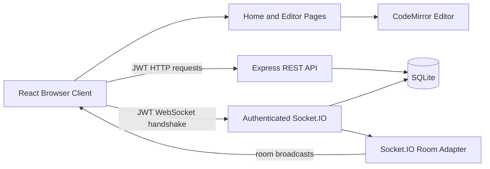
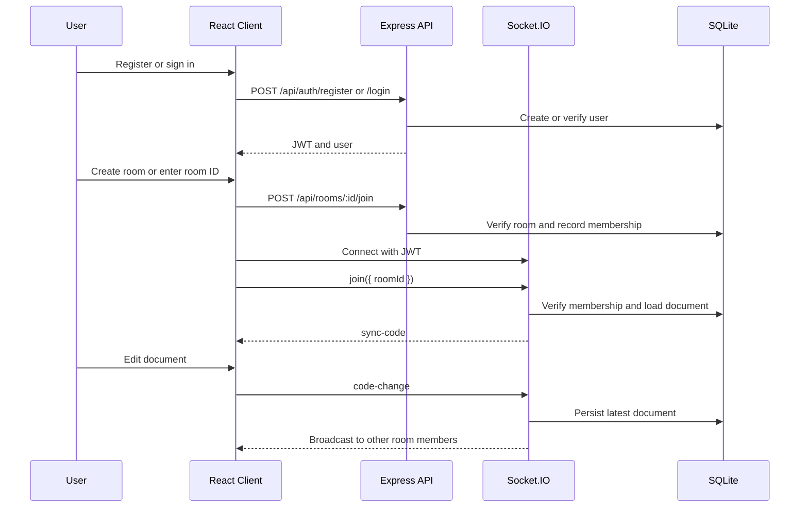

# CodeFusion

CodeFusion is a persistent, authenticated, real-time collaborative code editor built with React, Express, SQLite, and Socket.IO. Users can create or join protected rooms, edit a shared document, see participant presence, and switch between supported editor languages.

## Table of Contents

- [Features](#features)
- [Architecture](#architecture)
- [Technology Stack](#technology-stack)
- [Getting Started](#getting-started)
- [Environment Variables](#environment-variables)
- [Application Flow](#application-flow)
- [HTTP API](#http-api)
- [Socket.IO Protocol](#socketio-protocol)
- [Persistence Model](#persistence-model)
- [Consistency and Limitations](#consistency-and-limitations)
- [Security](#security)
- [Scaling Roadmap](#scaling-roadmap)
- [Project Structure](#project-structure)
- [Validation](#validation)

## Features

### Implemented

- User registration and login with JWT authentication.
- Password hashing with `bcryptjs`.
- Persistent users, rooms, current code, and language in SQLite.
- Room membership authorization.
- Authenticated Socket.IO connections.
- Real-time full-document code synchronization.
- Real-time language synchronization.
- Participant presence and disconnect notifications.
- Reconnection status in the editor UI.
- JavaScript, Python, HTML, and JSON CodeMirror modes.
- Server-side input validation and a 200 KB code payload limit.
- Responsive dark editor interface.

### Not implemented yet

- Conflict-free concurrent editing.
- Cursor and selection synchronization.
- Code execution.
- File trees or multi-file projects.
- Refresh-token rotation and password reset.
- Multi-instance Socket.IO scaling.

## Architecture



The current deployment is a single Node.js process. SQLite stores durable application data, while Socket.IO's default adapter stores active connections and room membership in process memory.

## Technology Stack

| Layer | Technology | Responsibility |
|---|---|---|
| Frontend | React 17 | UI and application lifecycle |
| Routing | React Router 6 | Home and `/editor/:roomId` routes |
| Editor | CodeMirror 5 | Syntax-aware browser editor |
| Backend | Node.js and Express | REST API and static hosting |
| Real-time layer | Socket.IO 4 | Authenticated room events |
| Database | SQLite via `better-sqlite3` | Users, rooms, membership, and latest document |
| Authentication | JWT and `bcryptjs` | Sessions and password hashing |

## Getting Started

### Prerequisites

- Node.js 18 or newer
- npm 9 or newer

### Install dependencies

```bash
npm install
```

### Development

Run the backend:

```bash
npm run server:dev
```

Run the React development server in a second terminal:

```bash
npm run start:front
```

Open `http://localhost:3000`.

If port `5000` is unavailable:

```bash
PORT=5050 npm run server:dev
```

When using a non-default backend port during frontend development, configure the frontend proxy or set `REACT_APP_BACKEND_URL` accordingly.

### Production

```bash
JWT_SECRET="replace-with-a-long-random-secret" npm start
```

This builds the React application and starts Express in production mode. The server serves the generated `build` directory and handles the SPA fallback.

## Environment Variables

| Variable | Default | Description |
|---|---|---|
| `PORT` | `5000` | HTTP and Socket.IO server port |
| `JWT_SECRET` | development fallback | Secret used to sign JWTs; set a strong value in production |
| `CLIENT_ORIGIN` | `*` | Allowed Socket.IO browser origin |
| `DATABASE_PATH` | `data/codefusion.db` | SQLite database path |
| `REACT_APP_BACKEND_URL` | current browser origin | Socket.IO server URL |

The development fallback JWT secret is intentionally only for local use. Never rely on it in a deployed environment.

## Application Flow



## HTTP API

All protected endpoints require:

```http
Authorization: Bearer <jwt>
```

### Authentication

#### `POST /api/auth/register`

Request:

```json
{
  "username": "sonam",
  "password": "password123"
}
```

Username must be 3–30 characters using letters, numbers, spaces, `_`, or `-`. Passwords must contain at least 8 characters.

#### `POST /api/auth/login`

Accepts the same username/password shape and returns a JWT on success.

#### `GET /api/me`

Returns the authenticated user.

### Rooms

#### `POST /api/rooms`

Creates a room for the authenticated user.

Optional request:

```json
{
  "name": "Interview practice"
}
```

#### `GET /api/rooms/:id`

Returns room metadata, the latest saved code, language, and owner ID.

#### `POST /api/rooms/:id/join`

Adds the authenticated user to the room membership table. The room must already exist.

#### `PATCH /api/rooms/:id`

Updates the latest room code and/or language for an existing member.

```json
{
  "code": "console.log('hello')",
  "language": "javascript"
}
```

The code payload is limited to 200 KB.

## Socket.IO Protocol

The client sends the JWT during the Socket.IO handshake:

```js
io(BACKEND_URL, {
  auth: { token: localStorage.getItem('codefusion_token') }
});
```

Event names are defined in [`src/Actions.js`](./src/Actions.js).

| Event | Direction | Payload | Purpose |
|---|---|---|---|
| `join` | Client → server | `{ roomId }` | Join an authorized room |
| `joined` | Server → room | `{ clients, username, socketId }` | Update presence |
| `sync-code` | Server → client | `{ code, language }` | Load persisted room state |
| `code-change` | Both directions | `{ roomId, code }` / `{ code }` | Synchronize and persist document |
| `language-change` | Both directions | `{ roomId, language }` / `{ language }` | Synchronize editor mode |
| `disconnected` | Server → room | `{ socketId, username }` | Remove a participant |
| `socket-error` | Server → client | `{ message }` | Report authorization or socket errors |

Before accepting room events, the server verifies the JWT and checks that the authenticated user belongs to the room.

## Persistence Model

The database is created automatically at `data/codefusion.db` unless `DATABASE_PATH` is set.

### `users`

Stores user IDs, unique usernames, password hashes, and creation timestamps.

### `rooms`

Stores room IDs, owner IDs, room names, the latest complete code document, language, and timestamps.

### `room_members`

Stores the many-to-many authorization relationship between users and rooms. The `(room_id, user_id)` pair is unique.

The database stores the latest document, not a document history or edit log.

## Consistency and Limitations

The current editor uses complete-document, last-write-wins synchronization:

1. A local CodeMirror change produces the full document string.
2. The client emits `code-change`.
3. The server validates the room and payload.
4. The server persists the latest document.
5. The server broadcasts the document to other room members.

If two users edit simultaneously, the later processed update can overwrite the earlier one. This is not a CRDT or Operational Transformation implementation and should not be described as conflict-free editing.

Initial synchronization is server-backed: a joining client receives the latest persisted code and language. Reconnection reloads room state through the normal room fetch and Socket.IO join flow.

## Security

Implemented protections include:

- Password hashing with `bcryptjs`.
- JWT verification for HTTP and Socket.IO requests.
- Room membership checks before joining and editing.
- Username validation.
- Code payload size limits.
- No arbitrary code execution in the server.

Production recommendations:

- Set a long, random `JWT_SECRET`.
- Use HTTPS/WSS.
- Replace wildcard CORS with the real frontend origin.
- Add rate limiting for authentication and socket events.
- Add refresh-token rotation and account recovery.
- Add database backups and encryption-at-rest where required.
- Isolate any future code execution in a hardened sandbox with CPU, memory, filesystem, network, and timeout restrictions.

## Scaling Roadmap

The current single-process design is appropriate for development and small deployments. For horizontal scaling:

1. Run multiple Node.js instances behind a load balancer.
2. Use the Socket.IO Redis adapter for cross-instance room broadcasts.
3. Use a shared managed database instead of local SQLite.
4. Configure health checks and graceful shutdown.
5. Add metrics for connection count, event latency, errors, and persistence failures.
6. Add a versioned event or CRDT/OT synchronization model for high-contention editing.

## Project Structure

```text
server.js                         Express API, SQLite, JWT, Socket.IO
package.json                      Scripts and dependencies
src/
  Actions.js                      Shared socket event names
  App.js                          React routes and toast provider
  socket.js                       Authenticated Socket.IO client
  components/
    Client.js                     Participant display
    Editor.js                     CodeMirror and document events
  pages/
    Home.js                       Authentication and room entry
    EditorPage.js                 Room, presence, language, and editor UI
  App.css                         Application styling
  App.test.js                     Frontend smoke test
public/                           Static assets and HTML shell
```

## NPM Scripts

```bash
npm run start:front   # Start the React development server
npm run server:dev    # Start the backend with Nodemon
npm run build         # Build the frontend
npm run server:prod   # Run the backend directly
npm start             # Build and run production mode
npm test              # Run frontend tests
```

## Validation

The repository has been validated with:

```bash
npm run build
npm test -- --watchAll=false
node --check server.js
```

An authenticated API smoke test also covers registration, room creation, and room retrieval.
