<div align="center">

# ⚡ CodeFusion

### Code together. Think together. Ship together.

**A real-time collaborative code workspace with CRDT-powered editing, shared presence, multi-file projects, browser-based execution, live preview, room chat, and shared notes.**

[](https://react.dev/)
[](https://vite.dev/)
[](https://yjs.dev/)
[](https://developer.mozilla.org/en-US/docs/Web/API/WebSocket)
[](https://microsoft.github.io/monaco-editor/)
[](https://nodejs.org/)

[Repository](https://github.com/SonamNarula/CodeFusion-a-collaborative-real-time-code-editor) · [Getting Started](#-getting-started) · [Architecture](#-architecture) · [Interview Handbook](#-technical-interview-handbook)

</div>

---

## Table of Contents

- [1. Project Overview](#1-project-overview)
- [2. Why CodeFusion?](#2-why-codefusion)
- [3. Feature Matrix](#3-feature-matrix)
- [4. Technology Stack](#4-technology-stack)
- [5. Architecture](#5-architecture)
- [6. Repository Structure](#6-repository-structure)
- [7. Getting Started](#-getting-started)
- [8. Configuration](#8-configuration)
- [9. Application Workflows](#9-application-workflows)
- [10. Collaboration and CRDT Design](#10-collaboration-and-crdt-design)
- [11. Data Model](#11-data-model)
- [12. WebSocket Protocol and Server Lifecycle](#12-websocket-protocol-and-server-lifecycle)
- [13. Editor and Workspace Internals](#13-editor-and-workspace-internals)
- [14. Code Execution and Preview](#14-code-execution-and-preview)
- [15. Security Model and Limitations](#15-security-model-and-limitations)
- [16. Reliability, Performance and Scaling](#16-reliability-performance-and-scaling)
- [17. API and Operational Endpoints](#17-api-and-operational-endpoints)
- [18. Testing and Validation](#18-testing-and-validation)
- [19. Troubleshooting](#19-troubleshooting)
- [20. Engineering Trade-offs](#20-engineering-trade-offs)
- [21. Roadmap](#21-roadmap)
- [22. Resume Positioning](#22-resume-positioning)
- [23. Technical Interview Handbook](#23-technical-interview-handbook)
- [24. Cross-Question Drill](#24-cross-question-drill)
- [25. Glossary](#25-glossary)

---

# 1. Project Overview

CodeFusion is a browser-based collaborative development environment. Multiple people can enter the same room, work on a shared multi-file project, see collaborators' presence and cursors, run supported code locally in their browsers, preview web files, and communicate without leaving the workspace.

The application is split into two deployable parts:

- **Client:** a React 18 single-page application bundled with Vite.
- **Server:** a Node.js/Express HTTP server with a WebSocket endpoint. It manages Yjs documents, awareness state, room connections, and persistent room snapshots.

The collaboration layer uses **Yjs**, a CRDT framework. Rather than broadcasting and replacing the entire source file after every keystroke, clients exchange Yjs synchronization messages and apply updates to shared document structures. This is designed to converge concurrent edits without requiring a central text-merge algorithm for every keystroke.

> **Implementation boundary:** this repository implements room-link-based collaboration, not account-based authentication. Anyone who obtains a valid room link/code can attempt to join that room. Treat links as shareable access credentials and do not use the current implementation for confidential source code without adding authorization.

## Project at a glance

| Area | Implementation |
|---|---|
| UI framework | React 18 |
| Build tool | Vite 5 |
| Code editor | Monaco Editor |
| Collaboration model | Yjs CRDT |
| Editor binding | `y-monaco` |
| Client provider | `y-websocket` |
| Server transport | `ws` |
| Sync protocol | `y-protocols` |
| Binary encoding | `lib0` |
| Server framework | Express 4 |
| Room persistence | Per-room Yjs binary snapshots (`.ydoc`) |
| Browser execution | Sandboxed iframe for JavaScript; Web Worker + Pyodide for Python |
| Web preview | Sandboxed iframe with linked local CSS/JS inlined |
| Routing | React Router 6 |

## What makes v2 different?

The previous repository implementation used a simpler full-document synchronization model. CodeFusion v2 uses a Yjs document model and a WebSocket synchronization protocol.

| Earlier implementation pattern | CodeFusion v2 |
|---|---|
| Complete document sent after a change | Incremental CRDT updates |
| Last-arriving complete snapshot could overwrite another user's edit | Yjs merges concurrent document updates |
| Single code document per room | Multiple named files represented in shared structures |
| Basic editor integration | Monaco models bound to Yjs text types |
| Basic room state | Shared files, notes, chat/console state and awareness |
| Socket.IO-based event layer in the earlier version | Native WebSocket transport using `ws` and Yjs protocol messages |

---

# 2. Why CodeFusion?

Remote pair programming and technical collaboration often involve several disconnected tools: a local editor, screen sharing, a chat window, a scratchpad, and a browser preview. That creates friction and makes it harder for participants to follow the same context.

CodeFusion brings the core collaboration loop into one room:

1. Create a room and share its link.
2. Collaborators join with a display name.
3. Everyone works against the same shared project state.
4. Remote edits, cursors, and selections are reflected through Yjs.
5. HTML projects can be previewed inside the workspace.
6. Supported JavaScript, TypeScript, and Python code can be run in the browser.
7. Chat and Markdown notes keep discussion close to the code.

## Intended use cases

- Pair programming and code reviews
- Technical interview practice
- Mentoring and guided walkthroughs
- Small coding workshops
- Remote debugging and collaborative prototyping
- Teaching programming concepts

---

# 3. Feature Matrix

The following describes functionality represented in the supplied v2 source tree.

| Capability | Implementation | Notes |
|---|---|---|
| Create a room | Client-generated room ID and route navigation | Room document is initialized when the server first loads it |
| Join by room code/link | Landing page input normalization | Room IDs are validated against a 3–64 character pattern |
| Display identity | Locally stored display name and color | No account or password system |
| Real-time document sync | Yjs + WebSocket | CRDT updates |
| Shared multi-file workspace | Yjs shared map and per-file text types | Create, rename, delete and download controls are part of the workspace UI |
| Monaco editor | Monaco Editor + `y-monaco` | One model/binding per active file model |
| Remote cursors | Yjs Awareness + Monaco binding | Name/color identity is broadcast as awareness state |
| Follow mode | Workspace/People interactions | Follow a collaborator's active cursor/file context |
| Shared Markdown notes | Yjs text type + Monaco + Markdown rendering | Rendered Markdown is sanitized with DOMPurify |
| Room chat | Shared room state | Messages appear in the room chat panel |
| Shared console | Shared room state | Run activity/output is visible in the workspace |
| JavaScript execution | Sandboxed iframe | Browser-side, with a timeout |
| TypeScript execution | Monaco TypeScript emit + JavaScript runner | TypeScript is transpiled before execution |
| Python execution | Pyodide in a Web Worker | Runtime is downloaded from a CDN on first run |
| HTML/CSS/JS preview | Generated `srcDoc` in sandboxed iframe | Local CSS/JS references are inlined |
| Responsive preview | Desktop/tablet/mobile widths | Presentation width changes; it is not a full device emulator |
| Command palette | React component | `Ctrl/Cmd + K` |
| Problems panel | Monaco model markers | Displays editor diagnostics |
| Dark/light theme | Theme context and Monaco themes | Theme is client UI state |
| Persistent room documents | Yjs binary snapshot per room | Server-side filesystem persistence |
| Health endpoint | `GET /api/health` | Reports process health, in-memory room count and uptime |

### Explicit non-goals / current limitations

- No user accounts, passwords, JWT authentication, or role-based access control.
- No server-side execution of submitted programs.
- No production-grade multi-instance coordination or shared distributed persistence.
- No guaranteed durability for every keystroke; snapshots are debounced.
- No guarantee that a room link is private once shared.
- No built-in database replication, backup service, or audit log.
- No guarantee that browser-side execution is equivalent to a hardened remote execution sandbox.

---

# 4. Technology Stack

## Frontend

| Technology | Role | Why it is used |
|---|---|---|
| React 18.3 | UI framework | Component-based workspace, hooks and state management |
| Vite 5.4 | Development server and bundler | Fast local feedback and production asset bundling |
| React Router 6 | Client-side routing | Landing route and room route |
| Monaco Editor 0.52 | Code editor | VS Code-derived editor experience, language services and diagnostics |
| `y-monaco` | CRDT/editor integration | Binds Monaco text models to Yjs shared text |
| `yjs` | Shared document model | CRDT state and update merging |
| `y-websocket` | Browser provider | WebSocket transport/provider lifecycle for Yjs |
| `lucide-react` | Icon system | Consistent interface icons |
| `marked` | Markdown parsing | Converts shared notes into HTML |
| `dompurify` | HTML sanitization | Sanitizes generated Markdown HTML before rendering |

## Backend

| Technology | Role | Why it is used |
|---|---|---|
| Node.js | Runtime | Runs the HTTP and WebSocket server |
| Express 4.19 | HTTP framework | Health endpoint and production static file hosting |
| `ws` | WebSocket server | Handles persistent browser connections |
| `yjs` | Shared document engine | Maintains room document state on the server |
| `y-protocols` | Sync and awareness protocols | Encodes/decodes document sync and presence messages |
| `lib0` | Binary utilities | Encodes and decodes protocol message types |
| Node `fs` | Persistence | Reads/writes room snapshot files |
| Node `http` | HTTP server | Hosts Express and upgrades matching requests to WebSockets |

## Runtime and development tooling

| Tool | Role |
|---|---|
| npm | Dependency installation and scripts |
| `concurrently` | Starts client and server development processes together |
| Vite | Frontend development and production build |
| Node `--watch` | Restarts backend when watched files change |

## Browser runtimes

| Runtime | Responsibility |
|---|---|
| Sandboxed iframe | JavaScript execution |
| Monaco TypeScript worker | TypeScript-to-JavaScript transpilation |
| Web Worker | Runs Python runtime without blocking the UI thread |
| Pyodide | Python runtime compiled for WebAssembly |
| Sandboxed preview iframe | Renders HTML/CSS/JS workspace preview |

### Dependency versions

The package manifests declare the following version ranges:

- React / React DOM: `^18.3.1`
- Vite: `^5.4.8`
- `@vitejs/plugin-react`: `^4.3.1`
- Monaco Editor: `^0.52.0`
- Yjs: `^13.6.18`
- `y-websocket`: `^2.0.4`
- `y-monaco`: `^0.1.6`
- Express: `^4.19.2`
- `ws`: `^8.18.0`
- `y-protocols`: `^1.0.6`
- `lib0`: `^0.2.97`

These are manifest ranges, not a claim that every dependency is pinned to an exact patch version.

---

# 5. Architecture

## 5.1 High-level architecture

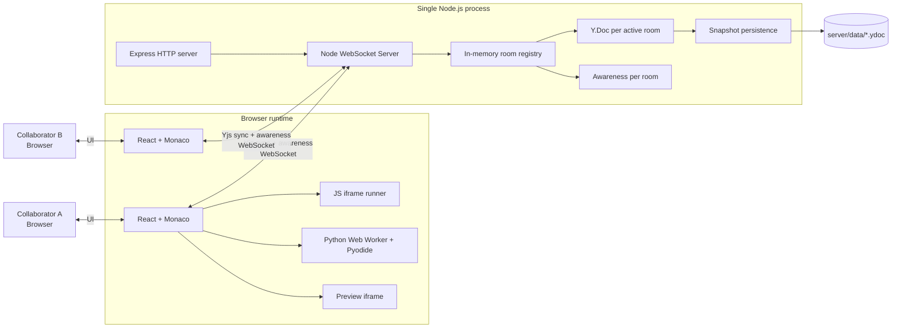

## 5.2 Main architectural responsibilities

### Browser client

- Renders the landing page and room workspace.
- Stores a local display profile in browser storage.
- Creates a Yjs document and WebSocket provider for a room.
- Binds Monaco editor models to Yjs shared text types.
- Displays awareness data such as users and cursor positions.
- Executes supported code in browser-managed runtimes.
- Builds and renders the HTML preview.

### Express / HTTP server

- Exposes `GET /api/health`.
- Serves `client/dist` when a production build exists.
- Shares the underlying Node HTTP server with the WebSocket upgrade handler.

### WebSocket collaboration server

- Accepts WebSocket upgrades under `/collab/:roomId`.
- Validates room ID syntax.
- Loads or creates a room document.
- Processes Yjs sync messages.
- Processes awareness updates.
- Broadcasts document and awareness updates to connected clients.
- Schedules persistence and evicts inactive in-memory rooms.

### Persistence layer

- Stores one binary Yjs snapshot per room.
- Uses a temporary file followed by rename when saving.
- Loads a snapshot when a room is first activated.
- Seeds a new room with starter files and shared notes if no snapshot exists.

## 5.3 Component architecture

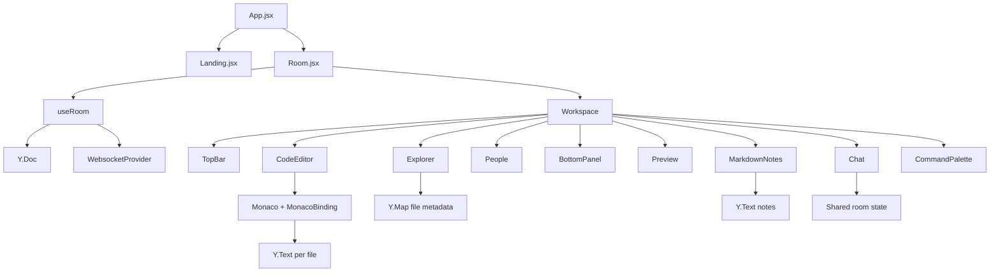

## 5.4 Current versus target architecture

The current server is a single Node.js process with process-local room objects and local filesystem snapshots. A production-scale deployment could evolve toward:

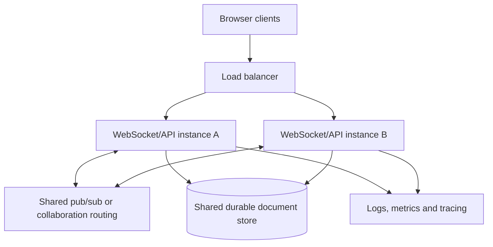

**This is a proposed evolution, not the current implementation.** The repository does not currently include a Redis adapter, a distributed room registry, a shared database, or multi-instance coordination.

---

# 6. Repository Structure

```text
CodeFusion/
├── package.json
├── README.md
├── .gitignore
│
├── server/
│   ├── index.js
│   ├── seed.js
│   ├── package.json
│   └── data/                  # Runtime snapshots; generated locally
│       └── <room-id>.ydoc
│
└── client/
    ├── package.json
    ├── vite.config.js
    ├── index.html
    ├── public/
    │   └── favicon.svg
    └── src/
        ├── main.jsx
        ├── App.jsx
        ├── components/
        │   ├── Workspace.jsx
        │   ├── CodeEditor.jsx
        │   ├── Explorer.jsx
        │   ├── People.jsx
        │   ├── Chat.jsx
        │   ├── MarkdownNotes.jsx
        │   ├── Preview.jsx
        │   ├── BottomPanel.jsx
        │   ├── CommandPalette.jsx
        │   ├── TopBar.jsx
        │   ├── StatusBar.jsx
        │   ├── Avatar.jsx
        │   ├── FileIcon.jsx
        │   ├── Logo.jsx
        │   ├── Splitter.jsx
        │   ├── RemoteCursorStyles.jsx
        │   └── context.jsx
        ├── hooks/
        │   ├── useRoom.js
        │   └── useReveal.js
        ├── lib/
        │   ├── collab.js
        │   ├── monacoSetup.js
        │   ├── preview.js
        │   ├── runners.js
        │   └── utils.js
        └── styles/
            ├── tokens.css
            ├── landing.css
            └── workspace.css
```

## Important modules

| File | Responsibility |
|---|---|
| `server/index.js` | Express app, HTTP server, WebSocket upgrade, Yjs sync, awareness, persistence and lifecycle |
| `server/seed.js` | Starter HTML, CSS, JavaScript, Python and Markdown content |
| `client/src/App.jsx` | Theme/toast providers and route configuration |
| `client/src/pages/Landing.jsx` | Create/join room flow and display-name entry |
| `client/src/pages/Room.jsx` | Validates room route, collects profile if missing, waits for initial sync |
| `client/src/hooks/useRoom.js` | Creates/destroys `Y.Doc` and `WebsocketProvider`; exposes sync and status |
| `client/src/components/Workspace.jsx` | Composes editor, explorer, people, notes, chat, preview and bottom panel |
| `client/src/components/CodeEditor.jsx` | Monaco editor lifecycle, models and `MonacoBinding` |
| `client/src/components/Explorer.jsx` | Shared file list and file operations |
| `client/src/components/People.jsx` | Awareness-based participant list and collaboration controls |
| `client/src/components/MarkdownNotes.jsx` | Shared notes editor and sanitized Markdown preview |
| `client/src/components/Chat.jsx` | Room chat UI |
| `client/src/components/Preview.jsx` | Builds and displays live HTML preview |
| `client/src/components/BottomPanel.jsx` | Shared console and Monaco diagnostics |
| `client/src/lib/collab.js` | Chooses the collaboration WebSocket URL |
| `client/src/lib/monacoSetup.js` | Monaco workers, compiler options, themes and model lookup |
| `client/src/lib/runners.js` | JavaScript, TypeScript and Python browser execution |
| `client/src/lib/preview.js` | Inlines local CSS/JS into the HTML preview document |
| `client/src/lib/utils.js` | Room IDs, profiles, file/language helpers and clipboard/download utilities |

---

# 7. Getting Started

## Prerequisites

- Node.js **18.11 or newer**
- npm
- A modern browser with WebSocket, iframe, Worker and WebAssembly support
- Internet access for installing dependencies and loading Pyodide on first Python run

Check your versions:

```bash
node --version
npm --version
```

## 7.1 Clone the repository

```bash
git clone https://github.com/SonamNarula/CodeFusion-a-collaborative-real-time-code-editor.git
cd CodeFusion-a-collaborative-real-time-code-editor
```

## 7.2 Install all dependencies

Run from the repository root:

```bash
npm run setup
```

The root setup script installs:
1. Root dependencies (`concurrently`).
2. Server dependencies.
3. Client dependencies.

If you prefer manual installation:

```bash
npm install
npm install --prefix server
npm install --prefix client
```

## 7.3 Start development

```bash
npm run dev
```

This starts both processes:

| Process | Default URL |
|---|---|
| Vite client | `http://localhost:5173` |
| Express + WebSocket server | `http://localhost:3001` |
| Collaboration endpoint | `ws://localhost:3001/collab/:roomId` |
| Health endpoint | `http://localhost:3001/api/health` |

Open **http://localhost:5173**.

## 7.4 Try a collaborative session

1. Open CodeFusion in a browser.
2. Enter a display name.
3. Select **Create a new room**.
4. Copy the room link/code.
5. Open the link in another browser or incognito window.
6. Enter a second display name.
7. Edit a file in either browser.
8. Confirm that edits and collaborator presence appear in both sessions.
9. Try the shared notes, chat, preview and console.

## 7.5 Production build

Build the client:

```bash
npm run build
```

The Vite output is generated in:

```text
client/dist/
```

Start the production server:

```bash
npm start
```

The server serves the built client when `client/dist` exists and accepts collaboration WebSocket upgrades on the same HTTP server.

---

# 8. Configuration

## Server environment variables

| Variable | Default | Purpose |
|---|---|---|
| `PORT` | `3001` | HTTP and WebSocket server port |
| `DATA_DIR` | `server/data` | Directory for room snapshot files |

Example:

```bash
PORT=4001 DATA_DIR=./server/data npm run dev
```

The server's WebSocket endpoint is derived from the client-side collaboration URL configuration.

## Client environment variable

| Variable | Default behavior | Purpose |
|---|---|---|
| `VITE_COLLAB_URL` | In development, `ws://<hostname>:3001/collab`; in production, same host using `ws` or `wss` | Overrides the collaboration WebSocket base URL |

For a custom local backend, create `client/.env.local`:

```env
VITE_COLLAB_URL=ws://localhost:4001/collab
```

Restart Vite after changing environment variables.

> Vite exposes variables prefixed with `VITE_` to browser code. Never place passwords, private keys, or server secrets in a `VITE_` variable.

---

# 9. Application Workflows

## 9.1 Create-room flow

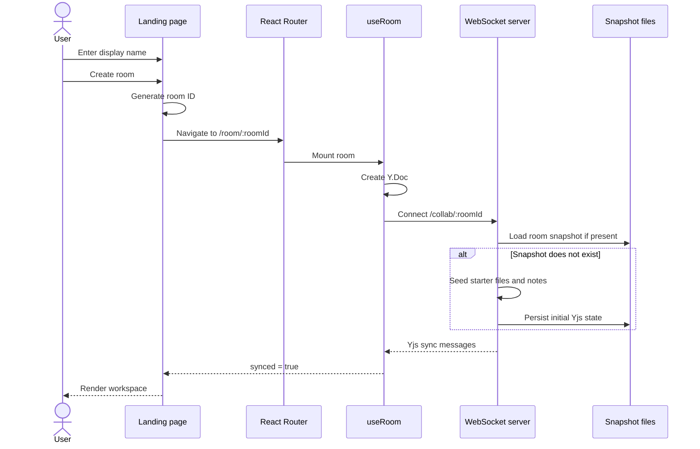

## 9.2 Join-room flow

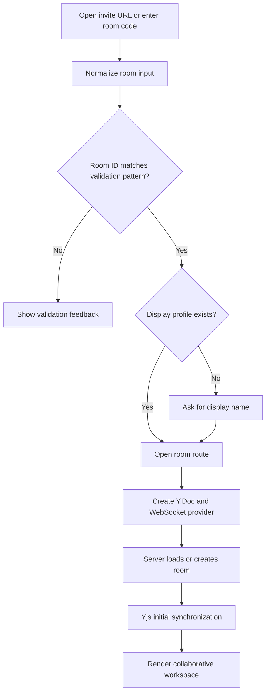

## 9.3 Edit propagation

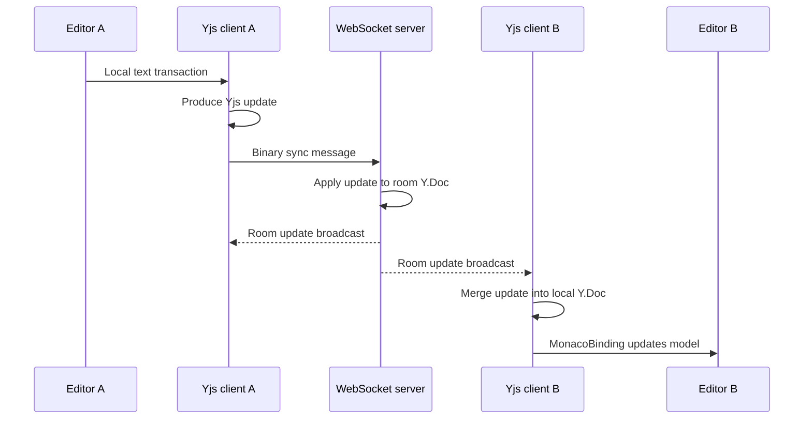

## 9.4 Reconnection and initial synchronization

A new client creates a local `Y.Doc` and connects through the provider. The server loads the room's persisted Yjs state and starts the Yjs sync handshake. The client and server exchange the state needed to bring their documents into sync.

The `useRoom` hook exposes:
- `room`: the document, provider and awareness objects.
- `status`: connection status.
- `synced`: whether the provider has completed its initial sync event.

The room page waits for the initial sync before rendering the full workspace. Once ready, it keeps the workspace mounted during temporary disconnects so the client can attempt to recover.

---

# 10. Collaboration and CRDT Design

## 10.1 What is a CRDT?

A **Conflict-free Replicated Data Type (CRDT)** is a data structure designed so independently updated replicas can merge changes and converge, provided they receive the same updates.

Yjs is a CRDT framework for collaborative applications. It represents shared state as Yjs types and produces updates that can be exchanged between peers or through a server.

## 10.2 Why Yjs instead of replacing the whole document?

With full-document last-write-wins synchronization, two users editing from the same starting text can overwrite each other's complete document.

Yjs uses structured updates and CRDT semantics. Concurrent edits can be merged rather than treating one entire text snapshot as the winner.

| Full-document replacement | Yjs CRDT |
|---|---|
| Sends the complete document snapshot | Sends encoded document updates |
| Concurrent edits can overwrite one another | Concurrent operations are designed to merge |
| Application must define snapshot ordering | CRDT metadata supports deterministic convergence |
| Simple but inefficient for frequent edits | More sophisticated state and protocol |
| No inherent shared cursor model | Awareness protocol can carry ephemeral presence |

## 10.3 Shared document structure

The server's seed logic and client components use shared Yjs structures.

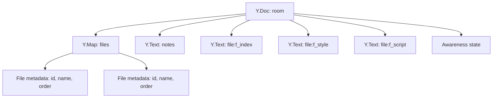

- `files` is a shared map containing file metadata.
- Each file's source is stored in a named `Y.Text` type such as `file:f_index`.
- `notes` is a shared text type.
- Awareness is used for transient user/presence information such as display name, color, cursor and active context.

## 10.4 Monaco binding

`CodeEditor.jsx` uses `MonacoBinding` to connect a Monaco model with a Yjs text type.

Conceptually:

```js
const ytext = doc.getText(`file:${file.id}`);

const binding = new MonacoBinding(
  ytext,
  model,
  new Set([editor]),
  awareness
);
```

The binding synchronizes local Monaco edits into Yjs and applies remote Yjs updates to the editor model.

The editor maintains models and bindings by file ID. When a file is renamed and its extension changes, the model/binding can be recreated with the correct language mode. When a file is removed, its model and binding are disposed.

## 10.5 Awareness and remote cursors

Yjs Awareness is designed for ephemeral state that should not be persisted as part of the document snapshot.

The room hook sets the local user identity:

```js
provider.awareness.setLocalStateField('user', {
  name: profile.name,
  color: profile.color
});
```

The editor updates the local cursor field:

```js
awareness.setLocalStateField('cursor', {
  file: fileId,
  line,
  column
});
```

The People UI derives peers from awareness states. The `usePeers` hook throttles UI recomputation to avoid rendering on every rapid awareness update.

**Important distinction:** document state is durable and synchronized; awareness is transient presence state. A user's cursor is not a durable edit history entry.

## 10.6 What Yjs does not automatically solve

Yjs provides collaboration primitives, but the application still has to handle:
- Room authorization and access policy.
- Persistence and backup strategy.
- Network failure and reconnect UX.
- Abuse prevention and rate limiting.
- Document schema evolution.
- Multi-instance routing and shared persistence.
- Product-level conflict UX for non-document state.

---

# 11. Data Model

CodeFusion uses Yjs documents rather than a relational SQL schema in this version.

## 11.1 Room snapshot model

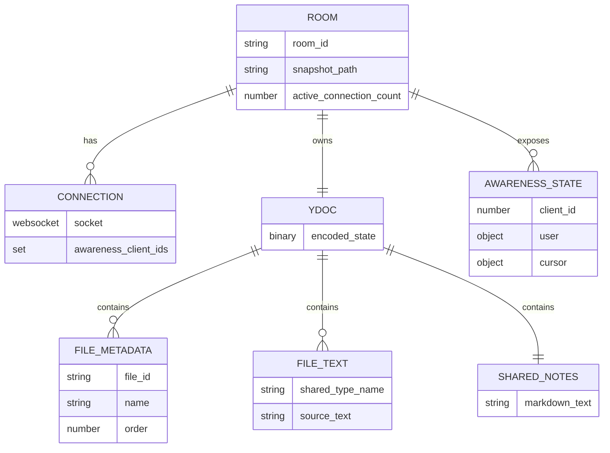

This is a conceptual model of the runtime structures, not a SQL ERD.

## 11.2 Snapshot files

The server stores one file per room:

```text
server/data/
├── swift-orbit-482.ydoc
├── lucid-pixel-193.ydoc
└── ...
```

The file contains an encoded Yjs document state, not a human-readable JSON export.

## 11.3 Snapshot write strategy

The server:
1. Listens for Yjs document updates.
2. Broadcasts the update to connected room sockets.
3. Schedules a save after a debounce interval.
4. Writes the encoded state to a temporary file.
5. Renames the temporary file to the room snapshot path.

The configured save debounce is **800 ms**.

This reduces repeated synchronous disk writes during bursts of edits. It also means the most recent edits may not yet be on disk if the process or machine fails before the scheduled save executes.

---

# 12. WebSocket Protocol and Server Lifecycle

## 12.1 Endpoint

```text
/collab/:roomId
```

Examples:

```text
ws://localhost:3001/collab/swift-orbit-482
wss://your-domain.example/collab/swift-orbit-482
```

The server accepts room IDs matching:

```regex
^[a-zA-Z0-9_-]{3,64}$
```

The WebSocket server is created with:
- `noServer: true`
- `maxPayload: 8 * 1024 * 1024` (8 MiB)

The HTTP server handles the upgrade and routes valid collaboration paths to the WebSocket server.

## 12.2 Message categories

The server uses two top-level message categories:

| Message type | Purpose |
|---|---|
| `MSG_SYNC = 0` | Yjs document synchronization |
| `MSG_AWARENESS = 1` | Awareness/presence updates |

`lib0/encoding` and `lib0/decoding` encode and decode the binary message envelope. `y-protocols/sync` handles document synchronization messages, while `y-protocols/awareness` handles awareness updates.

## 12.3 Connection lifecycle

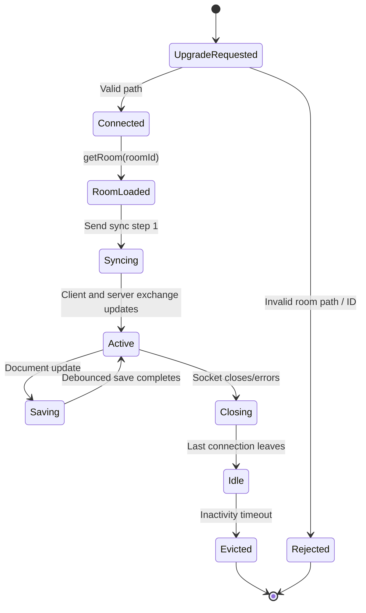

## 12.4 Room lifecycle values

| Setting | Current implementation |
|---|---|
| In-memory registry | `Map` keyed by room ID |
| Save debounce | 800 ms |
| Inactive room eviction delay | 60 seconds |
| Heartbeat interval | 30 seconds |
| Maximum WebSocket payload | 8 MiB |
| Snapshot format | Binary Yjs state update |
| Initial room state | Seeded starter workspace |

## 12.5 Room initialization

When `getRoom(roomId)` is called:
- If the room is already in memory, it is reused and its eviction timer is cleared.
- Otherwise, a new `Room` object is created.
- If a snapshot exists, the server applies it to the new Y.Doc.
- If no snapshot exists, starter files and notes are seeded and saved.

## 12.6 Disconnect handling

When a socket closes or errors:
- Its connection entry is removed.
- Awareness states associated with that connection are removed.
- If it was the last connection, the room is saved immediately.
- An eviction timer is scheduled.
- If a new client joins before eviction, the timer is cleared.

## 12.7 Heartbeat

The server pings connected clients every 30 seconds. If a client has not responded to the previous ping, the server terminates that connection. This helps clean up dead connections that otherwise may remain in the connection registry.

---

# 13. Editor and Workspace Internals

## 13.1 Monaco lifecycle

`CodeEditor.jsx`:
1. Creates a Monaco editor instance when the component mounts.
2. Registers the run shortcut (`Ctrl/Cmd + Enter`).
3. Tracks cursor movement.
4. Creates or reuses a Monaco model for the selected file.
5. Binds the model to the file's Yjs text type.
6. Switches the editor model when the active file changes.
7. Disposes bindings and models for deleted files.
8. Disposes the editor and subscriptions on unmount.

## 13.2 Language detection

The file extension is mapped to a Monaco language identifier. The helper supports common formats including JavaScript, TypeScript, JSX/TSX, Python, HTML, CSS, JSON, Markdown, Java, C, C++, Go, Rust, SQL, shell, YAML and XML.

Language highlighting/diagnostics are not the same as execution support. The documented execution runners specifically cover JavaScript, TypeScript and Python.

## 13.3 File operations

The Explorer UI works with shared file metadata. A file has a stable ID, a name and an order. Its source text lives in a separate Yjs text type keyed by that file ID.

This separation is useful because:
- File identity can remain stable when the name changes.
- Source text can be synchronized independently.
- Multiple files can exist inside one room document.
- The editor can bind only the active file's model.

## 13.4 Shared notes

The Markdown notes editor binds a Monaco model to the shared `notes` Y.Text. The preview uses `marked` to parse Markdown and DOMPurify to sanitize the resulting HTML before rendering.

## 13.5 Chat and shared console

The chat and console are room-level collaboration surfaces. The workspace presents messages and run entries alongside code so participants can follow the discussion and execution context.

The current implementation should be treated as a lightweight collaborative workspace, not a full audit/event-stream platform. It does not provide durable message retention guarantees, search indexing, moderation workflows or access roles.

---

# 14. Code Execution and Preview

## 14.1 Execution architecture

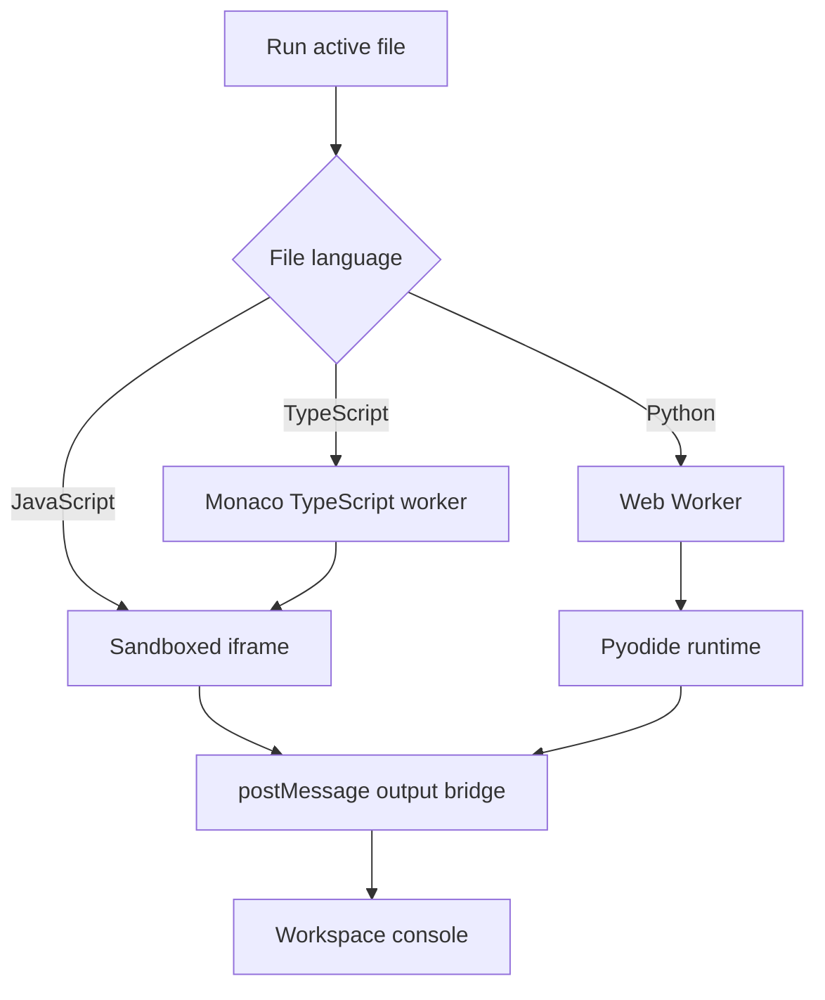

## 14.2 JavaScript runner

The JavaScript runner:
- Creates an iframe with the `sandbox="allow-scripts"` attribute.
- Injects a small bootstrap script that captures console output.
- Executes user code in the iframe context.
- Sends output back to the parent through `postMessage`.
- Listens for runtime errors and unhandled promise rejections.
- Enforces a 10-second timeout by default.
- Removes the iframe and event listener after completion.

This is browser-side execution. It is not a remote container runner and should not be described as a complete security sandbox against every browser exploit or resource-exhaustion scenario.

## 14.3 TypeScript runner

TypeScript is transpiled through Monaco's TypeScript worker. The emitted JavaScript is then passed to the JavaScript iframe runner.

The compiler options target modern JavaScript (`ES2020`) and configure module/JSX behavior for the editor environment.

## 14.4 Python runner

Python uses Pyodide:
- A Web Worker is created so execution does not block the main UI thread.
- Pyodide is loaded from its CDN on first execution.
- Python stdout and stderr are forwarded as console messages.
- A default 90-second timeout is applied.
- The worker is terminated on timeout/error cleanup.

**Network requirement:** the first Python run needs internet access to download the Pyodide runtime. A restrictive content-security policy or offline environment may prevent it from loading.

## 14.5 HTML preview

The preview builder:
1. Locates `index.html`, or the first HTML file if no `index.html` exists.
2. Finds local linked stylesheets and inlines their contents into `<style>` elements.
3. Finds local script references and inlines their contents into `<script>` elements.
4. Adds a console/error bridge.
5. Renders the result in a sandboxed iframe.

The preview supports desktop, tablet and mobile viewport widths. It is a responsive-width preview, not a complete browser/device emulator.

## 14.6 Security note for preview

The preview iframe has a sandbox policy that permits scripts, modals, forms and popups. It does not grant `allow-same-origin` in the current source. Still, previewed code is untrusted input and should be treated carefully. Production hardening should review iframe policy, message origin/source validation, resource loading, and content-security policy.

---

# 15. Security Model and Limitations

Security must be described honestly in a resume project and in a technical interview.

## 15.1 Implemented protections

- Room IDs are syntax-validated before WebSocket upgrade.
- WebSocket payload size is capped at 8 MiB.
- JavaScript execution occurs in a sandboxed iframe.
- Python execution occurs in a Web Worker.
- The HTML preview uses a sandboxed iframe.
- Markdown output is sanitized through DOMPurify.
- The server disables the Express `x-powered-by` header.
- WebSocket heartbeat detects stale connections.

## 15.2 Important gaps

| Area | Current state | Production recommendation |
|---|---|---|
| Authentication | No account authentication | Add identity provider or secure session authentication |
| Authorization | Room access is link/code based | Add membership checks and roles |
| Room ID entropy | Human-readable random room ID | Use cryptographically secure random IDs |
| Rate limiting | Not implemented | Limit room creation, connections and message rates |
| Abuse protection | Minimal | Add quotas, moderation and abuse reporting |
| Transport security | Depends on deployment | Enforce HTTPS/WSS in production |
| Persistence | Local filesystem snapshots | Managed durable storage, backups and recovery testing |
| Multi-instance | Process-local room map | Shared coordination and durable store |
| WebSocket origin policy | No explicit origin allowlist in current server code | Validate allowed origins and use an explicit deployment policy |
| Observability | Console logging | Structured logs, metrics and traces |
| Message validation | Binary protocol decoding with error handling | Add connection quotas and protocol-level abuse controls |

## 15.3 Room privacy

The landing page communicates that rooms are private to people with the link. This means **unlisted/link-accessible**, not authenticated or access-controlled. Anyone who receives or guesses a valid room ID can attempt to connect.

Do not store secrets, credentials, private keys, customer data or proprietary source code in a room until proper authentication and authorization have been added.

## 15.4 Browser execution is not server execution

CodeFusion does not execute user programs on the backend. JavaScript and TypeScript execute in a sandboxed browser iframe; Python executes in a browser worker using Pyodide.

If a future version adds server-side execution, it should use isolated containers or microVMs with:
- Unprivileged execution identity.
- CPU, memory and wall-clock limits.
- Filesystem isolation.
- Network restrictions.
- Process and output quotas.
- Cancellation and cleanup.
- Per-run isolation and monitoring.

---

# 16. Reliability, Performance and Scaling

## 16.1 Current reliability characteristics

| Scenario | Current behavior |
|---|---|
| New room | Server creates a Y.Doc and seeds initial files |
| Returning to an existing room | Server loads the saved snapshot |
| Multiple connected users | Updates are broadcast to room connections |
| One user disconnects | Their awareness state is removed |
| Last user disconnects | Room is saved and an eviction timer starts |
| User rejoins before eviction | Existing in-memory room is reused |
| Inactive room reaches eviction timeout | Room is saved and removed from memory |
| Server receives SIGINT/SIGTERM | Active room snapshots are saved before process exit |
| Server crashes unexpectedly | Last completed snapshot remains; changes since last save may be lost |

## 16.2 Performance considerations

### Update frequency

Yjs updates are broadcast as binary messages. The server schedules persistence with an 800 ms debounce rather than writing a complete snapshot for every update.

### Memory

Each active room has:
- A Y.Doc.
- An Awareness instance.
- A connection map.
- Timers and metadata.

Inactive rooms are evicted after the configured delay to limit retained in-memory state.

### Network

The server broadcasts document updates to all active connections in the room. Large rooms and high-frequency updates increase fan-out and network work.

### Editor rendering

Monaco is a feature-rich editor. It has a larger runtime footprint than a minimal text editor, but provides language-aware editing, diagnostics and a familiar IDE interaction model.

## 16.3 Scaling path

| Stage | Architecture | Required changes |
|---|---|---|
| Local / demo | One Node process + local snapshots | Current implementation |
| Small hosted deployment | One instance + persistent disk | Health checks, TLS, backups, limits |
| Multi-instance | Multiple WebSocket instances | Shared room routing and shared durable state |
| Larger collaboration workload | Dedicated collaboration infrastructure | Backpressure, room sharding, quotas and observability |
| Enterprise | Identity, roles and auditability | SSO, authorization, retention, monitoring and compliance controls |

## 16.4 Suggested production architecture

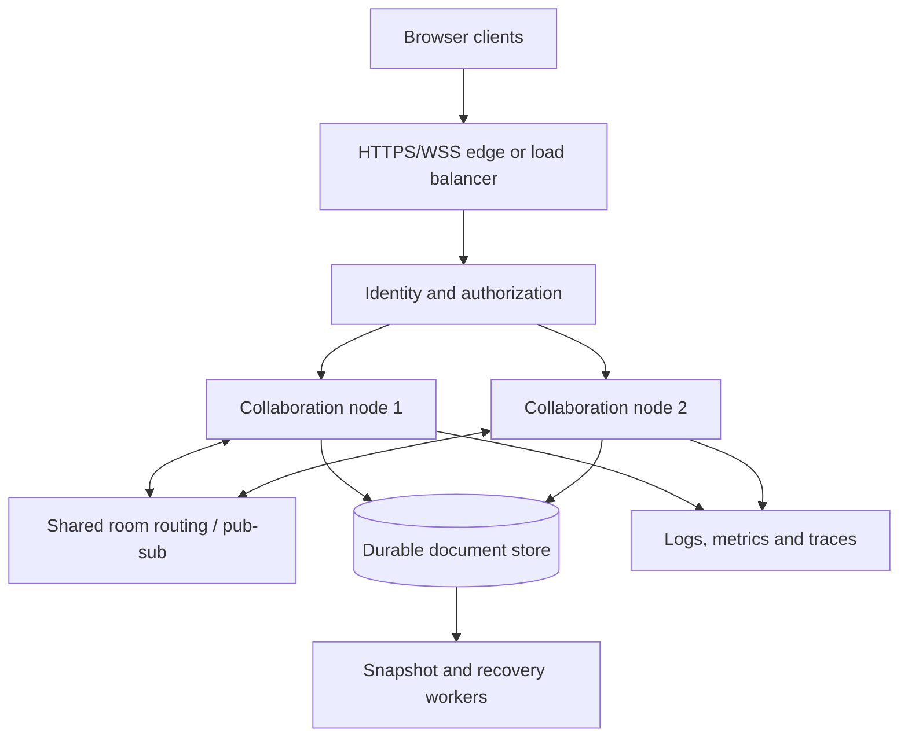

This is a future design proposal. It is not deployed by the current repository.

---

# 17. API and Operational Endpoints

## `GET /api/health`

Returns a lightweight health response:

```json
{
  "ok": true,
  "rooms": 2,
  "uptime": 123.45
}
```

Fields:
- `ok`: process health indicator.
- `rooms`: number of room objects currently held in the in-memory map.
- `uptime`: process uptime in seconds.

Example:

```bash
curl http://localhost:3001/api/health
```

## WebSocket endpoint

```text
GET /collab/:roomId
```

The endpoint upgrades a valid HTTP request to a WebSocket connection. The collaboration protocol uses binary Yjs sync and awareness messages.

There is no REST API for account registration/login in this version because the product currently uses display-name profiles rather than user accounts.

---

# 18. Testing and Validation

## 18.1 Build validation

Run:

```bash
npm run build
```

This checks that Vite can compile the client and generate production assets.

## 18.2 Manual functional test plan

### Room creation and joining
- [ ] Create a room with a display name.
- [ ] Copy the invite link.
- [ ] Open it in a second browser profile.
- [ ] Join with a different display name.
- [ ] Verify both users appear in the People panel.

### Collaborative editing
- [ ] Edit the same file from two clients.
- [ ] Make concurrent edits in different positions.
- [ ] Verify that both clients converge.
- [ ] Rename a file and verify the file list updates.
- [ ] Create and delete a file.
- [ ] Verify remote editor state follows the shared document.

### Presence
- [ ] Move the cursor in one client.
- [ ] Verify the remote cursor/selection appears in the other client.
- [ ] Disconnect one browser.
- [ ] Verify the participant disappears.
- [ ] Reconnect and verify presence returns.

### Notes and chat
- [ ] Edit shared Markdown notes from both clients.
- [ ] Verify preview output.
- [ ] Send messages from both clients.
- [ ] Verify message ordering and display.

### Execution and preview
- [ ] Run a JavaScript file.
- [ ] Run a TypeScript file.
- [ ] Run a Python file with internet access.
- [ ] Verify console output and error output.
- [ ] Create/edit `index.html`, CSS and JS.
- [ ] Verify live preview refresh.
- [ ] Test desktop/tablet/mobile preview widths.

### Persistence and recovery
- [ ] Create and edit a room.
- [ ] Wait for the save debounce.
- [ ] Stop and restart the server.
- [ ] Reopen the same room.
- [ ] Verify saved files and notes are restored.
- [ ] Test a room after the inactive-room eviction interval.

## 18.3 Important automated-test gap

The supplied v2 archive does not include a dedicated automated unit/integration test suite. The build command is available, but it should not be described as proof that every collaboration, persistence, security or runner path is tested.

A strong next step is to add:
- Unit tests for room ID validation and utility functions.
- Integration tests for WebSocket join/sync/disconnect behavior.
- Multi-client convergence tests for concurrent Yjs updates.
- Persistence round-trip tests.
- Browser-level tests for the primary user journeys.
- Security tests for invalid room IDs, oversized payloads and malformed messages.

---

# 19. Troubleshooting

| Symptom | Likely cause | What to check |
|---|---|---|
| Vite page opens but room never syncs | Backend not running or wrong WebSocket URL | Start server and inspect `VITE_COLLAB_URL` |
| WebSocket connection refused | Wrong port or server unavailable | Check `PORT` and server terminal |
| Room link is rejected | Invalid room ID format | Use 3–64 letters, digits, `_` or `-` |
| Python runner does not start | Pyodide CDN unavailable | Check internet access and browser console |
| Monaco editor is blank | Worker/model initialization issue | Inspect browser console and Vite worker build |
| Preview is empty | No HTML entry file | Add `index.html` |
| Room changes disappear after restart | Snapshot not yet saved or data directory is ephemeral | Check `DATA_DIR` and persistent disk configuration |
| Port already in use | Another process is listening | Change `PORT`, e.g. `PORT=4001` |
| Build output is missing | Client has not been built | Run `npm run build` |

### Find the process using a port (macOS/Linux)

```bash
lsof -nP -iTCP:3001 -sTCP:LISTEN
```

### Start on another port

```bash
PORT=4001 npm run dev
```

If the backend port changes, configure the client collaboration URL to match:

```env
VITE_COLLAB_URL=ws://localhost:4001/collab
```

---

# 20. Engineering Trade-offs

| Decision | Benefit | Cost / limitation | Possible evolution |
|---|---|---|---|
| Yjs CRDT | Concurrent document changes can merge | More complex state/protocol than snapshot replacement | Add convergence tests and schema/version policy |
| WebSocket | Persistent low-latency bidirectional channel | Requires lifecycle, heartbeat and reconnect handling | Add metrics, backpressure and distributed routing |
| Monaco | Rich IDE-style editing and diagnostics | Larger bundle/runtime footprint | Lazy-load editor and language services |
| Local filesystem snapshots | Simple persistence with no database service | Single-host storage and backup limitations | Shared durable object/database storage |
| Debounced snapshots | Reduces repeated disk writes | Small unsaved window after abrupt failure | Periodic checkpoints and durable update log |
| Browser-side execution | Avoids executing arbitrary code on the application server | Browser resource and isolation limitations | Dedicated hardened execution service if needed |
| Link-based rooms | Very low-friction onboarding | No identity, roles or access revocation | Authentication and room membership |
| One server process | Easy local development | No horizontal coordination | Shared room routing and durable state |
| Local profile storage | No sign-up friction | Identity is not verified | Authenticated user profiles |

---

# 21. Roadmap

The following are proposed enhancements, not claims about current functionality.

## Collaboration and document lifecycle
- [ ] Add explicit room ownership and membership.
- [ ] Add authenticated rooms and role-based permissions.
- [ ] Add room expiry and owner-controlled deletion.
- [ ] Add document schema/version migrations.
- [ ] Add snapshot integrity checks and recovery tooling.
- [ ] Add durable edit history or version checkpoints.

## Reliability
- [ ] Add automated Yjs convergence tests.
- [ ] Add persistence round-trip tests.
- [ ] Add explicit origin allowlisting.
- [ ] Add WebSocket connection and message rate limits.
- [ ] Add graceful shutdown that closes active sockets cleanly.
- [ ] Add structured logging and health/readiness separation.

## Performance and scale
- [ ] Add room-level connection quotas.
- [ ] Add backpressure and slow-client handling.
- [ ] Move snapshots to shared durable storage.
- [ ] Add multi-instance collaboration routing.
- [ ] Add load testing for concurrent rooms and large documents.
- [ ] Add metrics for active rooms, connections, update size and save latency.

## Product
- [ ] Add file tabs and richer workspace navigation.
- [ ] Add room-level permissions and invitation management.
- [ ] Add chat moderation and retention settings.
- [ ] Add accessible keyboard navigation.
- [ ] Add automated browser tests.
- [ ] Add deployment workflows and documented hosting configuration.

---

# 22. Resume Positioning

## Resume-ready project entry

**CodeFusion — Real-Time Collaborative Code Workspace**  
*React, Vite, Monaco Editor, Yjs, WebSockets, Node.js, Express*

- Built a browser-based collaborative coding workspace using **React, Monaco Editor and Yjs CRDTs**, enabling concurrent multi-user editing with synchronized document state and remote cursor awareness.
- Implemented a **WebSocket collaboration server** with per-room Yjs documents, binary synchronization messages, awareness propagation, debounced snapshot persistence and inactive-room eviction.
- Developed a multi-file workspace with shared Markdown notes, room chat, collaborator presence, command palette and responsive editor panels.
- Integrated browser-side **JavaScript/TypeScript execution and Python via Pyodide Web Workers**, alongside a sandboxed HTML/CSS/JS live-preview environment.

Only retain bullets that accurately reflect the code you have personally tested and can explain in an interview.

## 30-second explanation

"CodeFusion is a real-time collaborative coding workspace. The frontend is built with React and Monaco, while Yjs handles shared document state through a WebSocket connection. Each room maintains a Y.Doc containing file metadata, source text and shared notes. Yjs updates are synchronized between connected clients, while Awareness carries transient presence and cursor information. The backend persists room snapshots to disk. I also integrated browser-side JavaScript, TypeScript and Python execution, plus an HTML preview, shared notes and chat."

## 90-second explanation

"CodeFusion started with the problem of remote coding sessions being fragmented across editors, screen-sharing tools and chat. I built a room-based workspace where collaborators can edit a multi-file project together.

The key technical decision was using Yjs instead of broadcasting complete text snapshots. Each room has a Y.Doc. File metadata lives in a shared map, and each file's content is represented by a Y.Text. Monaco is connected to those shared text types using y-monaco, so local edits and remote updates flow through the same binding. Yjs Awareness carries transient user and cursor information.

On the backend, Node and Express host the HTTP server, while ws handles WebSocket upgrades. The server maintains active room documents in memory and persists encoded Yjs snapshots to disk using a debounced write strategy. When a room becomes inactive, it is saved and eventually evicted from memory.

Beyond collaboration, the workspace includes browser-side runners for JavaScript, TypeScript and Python, an HTML preview, shared notes and chat. The most important trade-off is that the current version prioritizes frictionless room-link access over account-based security and uses single-process local persistence, so authentication and distributed deployment are clear next engineering steps."

## What to be ready to explain

1. Why CRDT/Yjs instead of last-write-wins snapshots?
2. How does Yjs converge concurrent edits?
3. What is the difference between Y.Doc and Awareness?
4. How does MonacoBinding connect a Monaco model to Y.Text?
5. How does the WebSocket sync handshake work?
6. How are room documents persisted?
7. What happens if the server crashes before the debounce timer fires?
8. Why is the room map process-local?
9. How would you add authorization?
10. How would you scale the WebSocket server across multiple instances?
11. Why use a Worker for Python?
12. What does iframe sandboxing protect against, and what does it not guarantee?

---

# 23. Technical Interview Handbook

Answers below distinguish the current implementation from a proposed production design. Be precise about that distinction in interviews.

## A. Project fundamentals

### Q1. What is CodeFusion?

**Answer:** CodeFusion is a browser-based collaborative coding workspace. It combines a React/Monaco frontend, Yjs-based shared document state, WebSocket synchronization, room presence, multi-file editing, browser-side execution, preview, chat and notes.

### Q2. What problem does it solve?

**Answer:** It reduces the friction of pair programming and remote mentoring by keeping shared code, collaborator presence, execution output, preview and communication in one workspace.

### Q3. Why did you choose a room-based architecture?

**Answer:** A room is a natural collaboration boundary. It groups a shared document, connected clients, awareness state and persisted snapshot under one room identifier.

### Q4. What happens when a user creates a room?

**Answer:** The client generates a room ID and navigates to the room route. The room hook creates a Y.Doc and WebSocket provider. When the server receives the connection, it loads an existing snapshot or creates and seeds a new room document.

### Q5. Does CodeFusion have user authentication?

**Answer:** No. The current version uses a display name and color stored in browser local storage. Room access is link/code based. Authentication and authorization are future hardening work.

### Q6. What is the most technically interesting part?

**Answer:** The collaboration layer: Yjs shared types, Monaco binding, WebSocket synchronization, Awareness-based presence and server-side snapshot persistence.

## B. CRDT and Yjs

### Q7. What is a CRDT?

**Answer:** A Conflict-free Replicated Data Type is a data structure whose replicas can independently accept updates and merge them so they converge when they have received the same updates.

### Q8. Why use Yjs?

**Answer:** Yjs provides shared data types, efficient encoded updates, synchronization protocols and awareness primitives. It avoids implementing a custom concurrent text-merge algorithm.

### Q9. Is Yjs the same as WebSocket?

**Answer:** No. Yjs is the shared data/CRDT layer. WebSocket is the transport used to exchange synchronization and awareness messages.

### Q10. Is Yjs the same as OT?

**Answer:** No. Operational Transformation transforms operations according to concurrent edits and ordering. Yjs uses CRDT data structures and metadata to merge updates.

### Q11. What is a Y.Doc?

**Answer:** It is the top-level shared document container. It holds shared types such as Y.Map and Y.Text and produces updates when transactions change the document.

### Q12. What is Y.Text?

**Answer:** Y.Text is a shared text type designed for collaborative text editing. Each workspace file has its own Y.Text type.

### Q13. What is Y.Map?

**Answer:** Y.Map is a shared map structure. CodeFusion uses it for file metadata such as IDs, names and order.

### Q14. What is a Yjs update?

**Answer:** It is an encoded representation of document changes that can be applied to another Y.Doc. Yjs updates can be exchanged incrementally and merged.

### Q15. How are concurrent edits resolved?

**Answer:** Yjs uses CRDT semantics and internal ordering/identity metadata to merge concurrent operations. The replicas converge when they receive the relevant updates. The application still needs to test the behavior of its own document schema and UI.

### Q16. Does Yjs require a central server to merge every keystroke?

**Answer:** No. Clients can create updates independently. A server/provider can relay updates and persist state, but the CRDT model is not a central last-write-wins text replacement algorithm.

### Q17. What is Awareness?

**Answer:** Awareness is a separate mechanism for ephemeral presence information, such as user name, color, cursor and selection. It is not the durable document state.

### Q18. Why should cursor state not be stored as ordinary document text?

**Answer:** Cursor position is transient and changes frequently. It should not pollute document history or snapshots as normal source edits. Awareness is designed for that type of ephemeral state.

### Q19. What happens when a collaborator disconnects?

**Answer:** The server removes awareness states associated with that connection. The remaining clients receive the updated awareness state and the disconnected collaborator disappears from presence UI.

### Q20. Can Yjs updates arrive more than once?

**Answer:** Yjs updates are designed to be idempotent when applied to the same document state. The application should still consider transport errors, resource limits and persistence behavior.

## C. WebSocket and backend

### Q21. Why use WebSockets?

**Answer:** Collaborative editing needs a persistent bidirectional channel. WebSockets avoid repeatedly opening HTTP requests for every edit or presence update.

### Q22. Why use `ws` instead of Socket.IO?

**Answer:** The current server uses the lower-level `ws` package and speaks the Yjs synchronization/awareness protocol. Socket.IO adds its own event and room abstraction, which is not required for this protocol implementation.

### Q23. What does the HTTP upgrade do?

**Answer:** The browser begins with an HTTP request. If the server accepts the upgrade, the connection transitions to the WebSocket protocol and remains open for bidirectional messages.

### Q24. How are WebSocket paths routed?

**Answer:** The Node HTTP server listens for upgrade requests, parses the URL path, matches `/collab/:roomId`, validates the room ID and then hands the socket to the WebSocket server.

### Q25. What does `noServer: true` mean?

**Answer:** The WebSocket server does not bind its own listening port. The application controls the HTTP upgrade and explicitly passes accepted sockets to it.

### Q26. Why have a room registry?

**Answer:** It avoids constructing a new Y.Doc for every connection. Multiple sockets for the same room share the same in-memory room object.

### Q27. What is stored in the room connection map?

**Answer:** It maps each WebSocket connection to the set of Awareness client IDs associated with that connection. That supports cleanup when the socket closes.

### Q28. Why is the room map not enough for horizontal scaling?

**Answer:** It exists only inside one Node process. Another instance cannot see its room objects or sockets. A distributed deployment needs shared routing/coordination and shared durable persistence.

### Q29. What is the purpose of the heartbeat?

**Answer:** The server periodically pings sockets and terminates connections that fail to respond, helping clean up stale connections.

### Q30. Why validate the room ID?

**Answer:** It constrains the accepted path and prevents arbitrary room identifiers from being used to form snapshot paths. It is input validation, not authorization.

## D. Persistence

### Q31. How is a room saved?

**Answer:** The server encodes the current Y.Doc state as a binary update and writes it to a room-specific `.ydoc` file.

### Q32. Why save a binary snapshot?

**Answer:** Yjs has an encoded state representation that can be restored by applying the update to a new Y.Doc. It avoids inventing a custom JSON serialization for CRDT internals.

### Q33. Why debounce saves?

**Answer:** A burst of keystrokes can produce many updates. Debouncing groups them so the server performs fewer disk writes.

### Q34. What is the downside of debounced persistence?

**Answer:** There is a durability window. If the process or host crashes before the pending save executes, the most recent updates may not be present in the last snapshot.

### Q35. Why write to a temporary file and rename?

**Answer:** It reduces the chance that a crash during a write leaves the primary snapshot path containing a partially written file. The rename is used as the final replacement step.

### Q36. What happens when a room is inactive?

**Answer:** When its last connection leaves, the server saves it and schedules eviction. If no one reconnects before the eviction delay, the in-memory room is destroyed. Its snapshot remains on disk.

### Q37. Is local disk persistence production-ready?

**Answer:** It is appropriate for a simple single-instance deployment with persistent storage. It does not provide multi-host sharing, replication, automated backups or disaster recovery.

## E. React and Monaco

### Q38. Why Monaco?

**Answer:** Monaco provides a familiar IDE-like editing experience, language-aware models, diagnostics, themes and keyboard commands.

### Q39. What is a Monaco model?

**Answer:** A model represents the text content and language configuration of an editor document. The editor view can switch between models.

### Q40. Why keep a model per file?

**Answer:** Each file has independent content and language mode. A model per file allows the editor to switch files without treating the entire workspace as one text buffer.

### Q41. What does `MonacoBinding` do?

**Answer:** It connects a Monaco model to a Yjs shared text type and synchronizes local and remote edits.

### Q42. Why dispose the binding?

**Answer:** Bindings subscribe to document and editor events. Disposing them prevents stale listeners, memory leaks and updates targeting a model that is no longer active.

### Q43. Why use refs for editor instances?

**Answer:** Monaco editor instances are imperative objects. A ref keeps the instance stable across React renders without making the editor object itself part of render state.

### Q44. How are language modes selected?

**Answer:** The utility layer maps a file extension to a Monaco language identifier. That controls syntax highlighting and editor diagnostics.

## F. Execution and preview

### Q45. Where does JavaScript execute?

**Answer:** In a sandboxed iframe in the user's browser, not on the Node server.

### Q46. Why use an iframe?

**Answer:** It separates the executed code's browsing context from the main application context and allows the runner to capture console and error messages through a message bridge.

### Q47. Is an iframe a complete security sandbox?

**Answer:** No. The sandbox attribute restricts capabilities, but it is not a substitute for a hardened execution service or a complete browser threat model.

### Q48. How does TypeScript run?

**Answer:** Monaco's TypeScript worker emits JavaScript, which is then passed to the JavaScript runner.

### Q49. How does Python run?

**Answer:** Pyodide is loaded in a Web Worker. The worker executes Python and forwards stdout/stderr messages to the UI.

### Q50. Why use a Web Worker for Python?

**Answer:** It moves the runtime work away from the main UI thread, reducing the chance that computation freezes the interface.

### Q51. What is Pyodide?

**Answer:** Pyodide is a Python runtime compiled to WebAssembly for browser environments.

### Q52. Why might the first Python run be slower?

**Answer:** The runtime is loaded from a CDN on first use. Subsequent execution can reuse the worker/runtime while it remains alive.

### Q53. How is the preview assembled?

**Answer:** The preview builder finds an HTML entry file, inlines linked workspace CSS and JavaScript, adds a console bridge and renders the result in a sandboxed iframe.

### Q54. Is the mobile preview a real phone emulator?

**Answer:** No. It changes the iframe viewport width to common device dimensions. It does not emulate every browser, operating-system or hardware behavior.

## G. Security and production

### Q55. What is the biggest security limitation?

**Answer:** Room access is based on possession of the room link/code. There is no authenticated user identity or membership authorization in the current version.

### Q56. How would you add authentication?

**Answer:** Add an identity provider or secure session system, issue authenticated sessions, and associate users with room membership records. The WebSocket handshake should authenticate the user before allowing room access.

### Q57. How would you add authorization?

**Answer:** Model room membership and roles, then check authorization during both room connection and every privileged room operation.

### Q58. Why is room ID validation not enough?

**Answer:** Validation only checks whether an identifier has an acceptable format. It does not prove that the requester is allowed to access the room.

### Q59. How would you protect against WebSocket abuse?

**Answer:** Add origin validation, connection quotas, per-room limits, message-rate limits, payload validation, idle timeouts and monitoring.

### Q60. What if you add server-side code execution?

**Answer:** It should run in isolated containers or microVMs with strict CPU, memory, time, filesystem, process and network restrictions. It must not execute arbitrary code in the main application process.

---

# 24. Cross-Question Drill

These are the follow-ups that often distinguish someone who has used a library from someone who understands the system.

## Architecture cross-questions

**Q: Why not use REST polling for collaboration?**  
**A:** Polling introduces repeated request overhead and update delay. A persistent WebSocket connection is better suited to frequent bidirectional updates.

**Q: Why not send the whole Y.Doc snapshot after every edit?**  
**A:** Yjs updates allow incremental synchronization. Sending full snapshots repeatedly would increase bandwidth and discard the efficiency of the update protocol.

**Q: What is the source of truth?**  
**A:** The logical shared state is the Y.Doc. Connected clients hold replicas; the server maintains an active room replica and persists encoded snapshots for recovery.

**Q: Is the server authoritative for every keystroke?**  
**A:** No. Yjs clients can create updates locally. The server relays and applies updates and provides persistence in this architecture.

**Q: What if the client and server start with different states?**  
**A:** The Yjs sync protocol exchanges state information and updates so the replicas can converge.

**Q: Can a room exist without a connected user?**  
**A:** Its snapshot can remain on disk even when its in-memory Room object has been evicted.

**Q: What is the difference between a room ID and a user ID?**  
**A:** A room ID identifies a shared collaboration space. The current product does not implement authenticated user IDs; it uses a display profile.

## CRDT cross-questions

**Q: Does CRDT mean conflicts never happen?**  
**A:** It means concurrent updates can be merged according to the CRDT's rules and replicas converge. Product-level semantic conflicts can still exist, such as two users renaming a file differently.

**Q: Does Yjs guarantee that every update is persisted?**  
**A:** No. Yjs handles document state merging. Persistence is an application responsibility, and the current implementation uses debounced snapshots.

**Q: Can Awareness be restored from the snapshot?**  
**A:** Awareness is transient and is not the durable document state. Users republish their presence when they reconnect.

**Q: Why not store the cursor in Y.Text?**  
**A:** Cursor position is not document content. Awareness is better suited to ephemeral state.

**Q: What happens if a user closes a tab without a graceful disconnect?**  
**A:** The WebSocket close/error lifecycle and heartbeat help clean up stale connections and remove their awareness state.

**Q: How would you test convergence?**  
**A:** Create multiple Y.Doc replicas, apply concurrent edits independently, exchange updates in different orders, and assert that the resulting shared content/state converges.

## Backend cross-questions

**Q: Why use one HTTP server for Express and WebSockets?**  
**A:** It allows Express to handle HTTP routes while the same Node server handles WebSocket upgrade requests.

**Q: What does `maxPayload` protect against?**  
**A:** It caps the size of an incoming WebSocket message, limiting one class of oversized-message resource abuse.

**Q: Is 8 MiB a complete DoS defense?**  
**A:** No. It is one limit. Rate limits, connection caps, CPU/memory controls and origin policy are also needed.

**Q: Why use an in-memory Map?**  
**A:** It provides fast lookup and reuse of active room objects in a single process. It is not a distributed store.

**Q: What happens if two server instances receive connections for the same room?**  
**A:** Each could create its own in-memory Y.Doc and local connection set. Without shared routing/persistence coordination, updates could diverge. The current architecture is single-instance.

**Q: What is the difference between room eviction and room deletion?**  
**A:** Eviction removes an inactive room object from memory. It does not delete the persisted `.ydoc` snapshot.

## Persistence cross-questions

**Q: What if a process crashes during snapshot writing?**  
**A:** The temporary-file-and-rename pattern reduces partial replacement risk, but filesystem durability and crash consistency still depend on the host/filesystem. Recovery behavior should be tested.

**Q: Why not write every update synchronously?**  
**A:** That could create heavy disk I/O during active typing. Debouncing reduces write frequency at the cost of a small unsaved window.

**Q: How would you add version history?**  
**A:** Persist periodic snapshots and/or an append-only update log, associate them with timestamps and room revisions, and expose restore points.

**Q: How would you migrate snapshot formats?**  
**A:** Add a versioned metadata envelope or version marker and write migration/recovery code before changing the stored document schema.

## Frontend cross-questions

**Q: Why use a hook for the room?**  
**A:** It encapsulates document/provider lifecycle, connection status, initial sync and cleanup so the page does not manage low-level collaboration setup itself.

**Q: Why wait for initial sync?**  
**A:** It avoids showing an empty or incomplete workspace before the server's shared state has arrived.

**Q: Why keep the workspace mounted after the first sync?**  
**A:** It preserves the local UI/editor context during temporary connection drops while the provider attempts to reconnect.

**Q: What if the user switches files while a remote update arrives?**  
**A:** Each file has its own Y.Text and Monaco model binding, so the update belongs to that file's shared model even if it is not currently active.

**Q: Why use `usePeers` throttling?**  
**A:** Awareness can update frequently. Throttling UI state recomputation reduces unnecessary React renders.

## Security cross-questions

**Q: Is a random-looking room ID equivalent to authentication?**  
**A:** No. It is an access-by-possession mechanism, not proof of identity. A leaked link grants access.

**Q: What would room authorization look like?**  
**A:** Authenticate the WebSocket handshake, load the user identity, check room membership/role and reject unauthorized upgrades or joins.

**Q: Why sanitize Markdown?**  
**A:** Markdown can generate HTML. Sanitization reduces the risk of injecting unsafe markup when rendering user-authored notes.

**Q: Does iframe sandboxing eliminate all risks?**  
**A:** No. It limits selected browser capabilities, but browser bugs, resource exhaustion, messaging mistakes and unsafe policies still need consideration.

**Q: Why validate `postMessage` source?**  
**A:** The parent should only accept messages from the expected iframe window, not arbitrary windows on the page.

## Scaling cross-questions

**Q: What becomes the bottleneck first?**  
**A:** Depending on workload, WebSocket fan-out, active room memory, snapshot serialization/disk writes and large Monaco documents can become bottlenecks.

**Q: How would you scale to multiple instances?**  
**A:** Introduce shared room routing/pub-sub, shared durable persistence, connection-aware routing and a deployment strategy that preserves the Yjs sync model across instances.

**Q: Would Redis alone solve horizontal scaling?**  
**A:** Not automatically. It can provide pub/sub or routing primitives, but the application still needs a consistent room ownership/routing strategy and shared persistence.

**Q: How would you handle a slow client?**  
**A:** Monitor buffered bytes, cap queued data, apply backpressure or disconnect persistently slow clients, and let them resynchronize after reconnect.

**Q: How would you load test this system?**  
**A:** Simulate multiple rooms and clients, generate edits and awareness updates, and measure connection success, sync latency, update throughput, memory, event-loop delay and snapshot write latency.

---

# 25. Glossary

| Term | Meaning |
|---|---|
| CRDT | Conflict-free Replicated Data Type |
| Yjs | CRDT framework for collaborative applications |
| Y.Doc | Top-level Yjs shared document |
| Y.Text | Shared collaborative text type |
| Y.Map | Shared map type |
| Awareness | Ephemeral presence/cursor state protocol |
| Monaco Editor | Browser code editor derived from VS Code |
| Monaco model | Text model and language configuration for an editor document |
| MonacoBinding | Binding between a Monaco model and a Yjs shared text type |
| WebSocket | Persistent, bidirectional network protocol |
| WebSocket upgrade | HTTP-to-WebSocket protocol transition |
| Snapshot | Persisted representation of a document state |
| Debounce | Delay/coalesce repeated operations until activity pauses |
| Pyodide | Python runtime for browser environments via WebAssembly |
| Web Worker | Browser background execution context |
| Vite | Frontend development server and build tool |
| DOMPurify | HTML sanitization library |
| Backpressure | Mechanism to prevent producers from overwhelming consumers |
| Horizontal scaling | Adding more service instances |
| Awareness state | Transient information about active collaborators |

---

<div align="center">

### Built for the moments when the best code is written together.

**CodeFusion — Collaborate. Code. Ship faster.**

[Back to top](#-codefusion)

</div>
